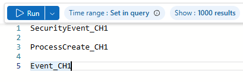

# PART2: Challenge 1 - Lab Walthrough.


## Getting started.

### Tables to use

There are several watchlist tables you need to remember, avaliable in Sentinel.

- `SecurityEvent_CH1`
- `ProcessCreate_CH1`
- `Event_CH1`




This is because, the query logic assessed in Challenge 1 uses these tables.
All tables are generated with the same kill chain, lab and hydration configuration. So it is consistant over both time and entities.

In the Lab portion (and video) of Challenge 1, there are four rules we will assess for Detection Logic Bugs using ADE methods.

### Emulation

We will be assessing the 3 rules in the walkthrough, against atomics that you can emulate.

These are in the [emulation guide](TO_UPLOAD\PART2_ADE101_Lab\Lab_Notes\emulation-guide.md)

In the CTF, we will expand out the scenario, and you will assess related rules for bypasses and the abuse in the logs. You will be given hints.

### Each query comes in two forms.

#### 1. Symon forwarding from VMs.

Detectio logic for the rules/hunts with bugs, ported to use Symon table but retaining the logic from the original table (because your vm sends syslog).

#### 3. Hayabusa (no log forwarding)

If for some reason, you can't see your VM logs in Sysmon during your emulation, then that's ok as long as Sysmon is running on your VM.

You can you the provided Hayabusa rules, which I have ported from KQL to Sigma, and test bug vs fix DFIR-style!

Whats more, in July this year, SigmaHQ fixed the detection logic bugs they had in their process creation ruleset. So we can run fixes and see where the bugs existed before.

The key thing is, you can emulate and review hits without a lab connection with this! But, you should try with the Sysmon logging first as hayabusa versions are backups.

---

# Goal of the labs: The goal of the lab is for you to walk through the process of assessing detection logic like an attacker.


# Let's look at a few of rules

## 1. Certutil (LOLBins and LOLScripts, Normalized Process Events)

**Github:**  [Original Rule](https://github.com/Azure/Azure-Sentinel/blob/master/Hunting%20Queries/ASimProcess/imProcess_Certutil-LOLBins.yaml).

**Description:**
>This detection uses Normalized Process Events to hunt Certutil activities

**Saved Hunt**
```m
ProcessCreate_CH1
| where Process has "certutil.exe"
// Uncomment the next line and add your commandLine Whitelisted/ignore terms.For example "urlcache"
// | where CommandLine !contains ("urlcache") 
| extend HostCustomEntity = Dvc, AccountCustomEntity = User
```

**Port to use Symon table**

Same name-only logic (the ADE3-01 bug), run over the lab `Sysmon()` parser function. It returns named columns (`Image`, `CommandLine`, `User`, …), so no `EventData` parsing is needed; `EventID == 1` is process creation (equivalently `EventCategory == "ProcessCreate"`).

```m
Sysmon()
| where EventID == 1
| where Image has "certutil.exe"
// Uncomment the next line and add your commandLine Whitelisted/ignore terms. For example "urlcache"
// | where CommandLine !contains ("urlcache")
| extend HostCustomEntity = Computer, AccountCustomEntity = User
```


**Hayabusa**

Found in workshop dir [here](../sentinel_busa/certutil_lolbins_ade3-01.yml)
```yaml
title: Sentinel Certutil LOLBins (name-based) - ADE3-01 BUGGY
id: a1b2c3d4-0001-4a01-8b01-000000000001
status: experimental
description: |
  Sigma port of Azure Sentinel's imProcess_Certutil-LOLBins hunting query.
references:
  - https://github.com/Azure/Azure-Sentinel/blob/master/Hunting%20Queries/ASimProcess/imProcess_Certutil-LOLBins.yaml
author: sentinel_busa
date: 2026-10-19
logsource:
  product: windows
  category: process_creation
detection:
  selection:
    Image|endswith: '\certutil.exe'
  condition: selection
falsepositives:
  - Legitimate certutil usage
level: medium
tags:
  - attack.defense_evasion
  - attack.t1140
details: 'Image: %Image% | OriginalFileName: %OriginalFileName% | Cmd: %CommandLine% | Parent: %ParentImage%'
```


## 2. CertUtil Used for File Download (Living off the Land)

**Github:**  [Original Rule](https://github.com/Azure/Azure-Sentinel/blob/master/Solutions/Endpoint%20Threat%20Protection%20Essentials/Analytic%20Rules/Certutil-Download-Abuse.yaml)

**Description:**
>Detects certutil.exe being used to download files from remote URLs via the
  -urlcache or -verifyctl flags. CertUtil is a signed Windows binary (LOLBin)
  that attackers abuse to download payloads while bypassing application
  whitelisting and network controls.
  Tune AllowlistedDomains to match your PKI/CA infrastructure.


**Saved Hunt**
```m
let Lookback = 12h;
  let AllowlistedDomains = dynamic([
    "windowsupdate.microsoft.com",
    "download.microsoft.com",
    "dl.delivery.mp.microsoft.com",
    "ctldl.windowsupdate.com"
  ]);
  let MDE_Results =
    DeviceProcessEvents
    | where Timestamp >= ago(Lookback)
    | where FileName =~ "certutil.exe"
    | where ProcessCommandLine has_any ("-urlcache", "-verifyctl", "-decode", "-decodehex")
    | where ProcessCommandLine has_any ("http://", "https://", "ftp://")
    | where not(ProcessCommandLine has_any (AllowlistedDomains))
    | extend
        AccountName   = InitiatingProcessAccountName,
        AccountDomain = InitiatingProcessAccountDomain,
        HostName      = DeviceName,
        EventTime     = Timestamp
    | project EventTime, HostName, AccountName, AccountDomain,
        ProcessCommandLine, InitiatingProcessFileName;
  let SecEvent_Results =
    SecurityEvent_CH1
    | where EventID == 4688
    | where NewProcessName endswith "\\certutil.exe"
    | where CommandLine has_any ("-urlcache", "-verifyctl", "-decode", "-decodehex")
    | where CommandLine has_any ("http://", "https://", "ftp://")
    | where not(CommandLine has_any (AllowlistedDomains))
    | extend
        AccountName   = SubjectUserName,
        AccountDomain = SubjectDomainName,
        HostName      = Computer,
        EventTime     = TimeGenerated,
        ProcessCommandLine = CommandLine,
        InitiatingProcessFileName = ParentProcessName
    | project EventTime, HostName, AccountName, AccountDomain,
        ProcessCommandLine, InitiatingProcessFileName;
  union MDE_Results, SecEvent_Results
  | sort by EventTime desc
```

Note here ^ the relevant part is the `SecEvent_Results` table, as we do not have DeviceProcessEvents in the watchlist.

**Port to use Symon table**

Same logic as the `SecEvent_Results` branch (name match **and** a required URL — the ADE3-01 + ADE2-04 double miss), run over the lab `Sysmon()` parser function. `Sysmon(ago(12h))` preserves the original rule's 12h lookback.

```m
let AllowlistedDomains = dynamic([
    "windowsupdate.microsoft.com",
    "download.microsoft.com",
    "dl.delivery.mp.microsoft.com",
    "ctldl.windowsupdate.com"
]);
Sysmon(ago(12h))
| where EventID == 1
| where Image endswith "\\certutil.exe"
| where CommandLine has_any ("-urlcache","-verifyctl","-decode","-decodehex")
| where CommandLine has_any ("http://","https://","ftp://")
| where not(CommandLine has_any (AllowlistedDomains))
| extend HostName = Computer, EventTime = TimeGenerated
| project EventTime, HostName, User, CommandLine, Image
| sort by EventTime desc
```

**Hayabusa**

Found in workshop dir [here](../sentinel_busa/certutil_download_abuse_ade3-01_ade2-04.yml)
```yaml
title: Sentinel Certutil Download-Abuse (name + required URL) - ADE3-01 + ADE2-04 BUGGY
id: a1b2c3d4-0002-4a01-8b01-000000000002
status: experimental
description: |
  Sigma port of Azure Sentinel's Certutil-Download-Abuse analytic rule.
references:
  - https://github.com/Azure/Azure-Sentinel/blob/f6cc4352c34b84d781735967808cfc953376e7f2/Solutions/Endpoint%20Threat%20Protection%20Essentials/Analytic%20Rules/Certutil-Download-Abuse.yaml
author: sentinel_busa
date: 2026-10-19
logsource:
  product: windows
  category: process_creation
detection:
  name:
    Image|endswith: '\certutil.exe'
  action:
    CommandLine|contains:
      - '-urlcache'
      - '-verifyctl'
      - '-decode'
      - '-decodehex'
  url:
    CommandLine|contains:
      - 'http://'
      - 'https://'
      - 'ftp://'
  condition: name and action and url
falsepositives:
  - Legitimate certutil network retrieval
level: medium
tags:
  - attack.defense_evasion
  - attack.t1105
  - attack.t1140
details: 'Image: %Image% | OriginalFileName: %OriginalFileName% | Cmd: %CommandLine% | Parent: %ParentImage%'
```

## 3. Malware in the recycle bin (Normalized Process Events)

**Github:**  [Original Rule](https://github.com/Azure/Azure-Sentinel/blob/master/Detections/ASimProcess/imProcess_malware_in_recyclebin.yaml)

**Description**:
> 'Identifies malware that has been hidden in the recycle bin.
  To use this analytics rule, make sure you have deployed the [ASIM normalization parsers](https://aka.ms/ASimProcessEvent)'

**Saved Hunt**

```m
let procList = dynamic(["cmd.exe","ftp.exe","schtasks.exe","powershell.exe","rundll32.exe","regsvr32.exe","msiexec.exe"]);  
  ProcessCreate_CH1
  | where CommandLine has "recycler"
  | where Process has_any (procList)
  | extend FileName = tostring(split(Process, '\\')[-1])
  | where FileName in~ (procList)
  | project TimeGenerated, Dvc, User, Process, FileName, CommandLine, ActingProcessName  // EventVendor, EventProduct not included in data, no impact on logic bug.
  | extend AccountName = tostring(split(User, @'\')[1]), AccountNTDomain = tostring(split(User, @'\')[0])
  | extend HostName = tostring(split(Dvc, ".")[0]), DomainIndex = toint(indexof(Dvc, '.'))
  | extend HostNameDomain = iff(DomainIndex != -1, substring(Dvc, DomainIndex + 1), Dvc)
  | project-away DomainIndex
```

**Port to use Symon table**

Same legacy-`recycler`-only logic (the ADE2-03 bug — it never matches the modern `$Recycle.Bin` path), run over the lab `Sysmon()` parser function.

```m
let procList = dynamic(["cmd.exe","ftp.exe","schtasks.exe","powershell.exe","rundll32.exe","regsvr32.exe","msiexec.exe"]);
Sysmon()
| where EventID == 1
| where CommandLine has "recycler"          // <-- the bug: legacy path only
| where Image has_any (procList)
| extend FileName = tostring(split(Image, '\\')[-1])
| where FileName in~ (procList)
| extend HostName = Computer, AccountName = User
| project TimeGenerated, Computer, AccountName, Image, FileName, CommandLine
```

**Hayabusa**

Found in workshop dir [here](../sentinel_busa/malware_in_recyclebin_ade2-03.yml)
```yaml
title: Sentinel Malware in the Recycle Bin (legacy path) - ADE2-03 BUGGY
id: a1b2c3d4-0003-4a01-8b01-000000000003
status: experimental
description: |
  Sigma port of Azure Sentinel's imProcess_malware_in_recyclebin rule.
references:
  - https://github.com/Azure/Azure-Sentinel/blob/master/Detections/ASimProcess/imProcess_malware_in_recyclebin.yaml
author: sentinel_busa
date: 2026-10-19
logsource:
  product: windows
  category: process_creation
detection:
  procs:
    Image|endswith:
      - '\cmd.exe'
      - '\ftp.exe'
      - '\schtasks.exe'
      - '\powershell.exe'
      - '\rundll32.exe'
      - '\regsvr32.exe'
      - '\msiexec.exe'
  location:
    CommandLine|contains: 'recycler'
  condition: procs and location
falsepositives:
  - Unlikely
level: high
tags:
  - attack.defense_evasion
  - attack.t1564.001
details: 'Image: %Image% | Cmd: %CommandLine% | Parent: %ParentImage%'
```


