# Challenge 1, .. Host intrusion (Windows endpoint)

- **Watchlist ids:** `c1-securityevent`, `c1-sysmon`
- **Difficulty:** Moderate ·
- **Tables:** `SecurityEvent` (4688), `Event`/`WindowsEvent` (Sysmon 1/3/7/11)

A web-facing IIS host (`WEB01`) is taken over via a fileless foothold (Roslyn compiles the implant *in-process*, so no compiler child, no DLL on disk), the follow-on
tooling is launched off `w3wp` via WMI, and the payload is staged inside the recycle
bin via `certutil -decode` (no network). Three genuine in-scope ADE logic bugs allowed it to take place (assuming no EDR).

> **Background**
Why the recycle bin is writable? The `$Recycle.Bin\<SID>` folder used for staging belongs to `noah.kim`, the sysadmin who manages `WEB01` (he RDPs into it regularly, see *Shared entities* below). Months earlier, while debugging an unrelated permissions issue, he loosened the ACL on his own profile/recycle-bin folders (e.g. an `icacls ... /grant Everyone:F`-style fix) to unblock himself.... and never reverted it... The low-privilege `IIS APPPOOL\app` identity has no special access of its own **but** that leftover misconfiguration. Nothing in the chain requires `IIS APPPOOL\app` to be anything other than its normal unprivileged self.

## Mechanical chain
`emit-in-proc (Roslyn)` → `WMI spawn (WmiPrvSE parent)` → `drop+rename signed certutil into $Recycle.Bin` → `it -decodes/stages p.dll` → `rundll32 runs the staged DLL` → `rundll32 → PowerShell cradle → downloads + runs s.exe → C2 beacon (from s.exe)`

## Attack chain over time

```mermaid
flowchart TD
    S1["T0 · Foothold (logic bug; classic rule = NewChildProcessOfW3WP, also ADE3-02)<br/>webshell uses Roslyn (Microsoft.CodeAnalysis) to compile IN-PROCESS<br/>Emit→MemoryStream, Assembly.Load(bytes)<br/>no csc.exe, no VBCSCompiler.exe, no disk DLL, no child process<br/>only tell: w3wp loads Microsoft.CodeAnalysis* (Sysmon 7)"]
    S2["T0 +30s · Ingress/Staging (laundered via WMI)<br/>WmiPrvSE.exe → svc_update.exe (renamed SIGNED certutil) in $Recycle.Bin<br/>-decode upd.b64 → p.dll (no network)<br/>Certutil LOLBins, .. ADE3-01 process cloning"]
    S3["T0 +2m · Execution<br/>rundll32 runs the staged DLL from the modern $Recycle.Bin path<br/>Malware in recycle bin, .. ADE2-03 locations"]
    S4["T0 +5m · C2<br/>rundll32 → PowerShell concat cradle → beacon<br/>PowerShell Downloads, .. ADE1-01 substring"]
    S5["T0 +5m06s · Payload<br/>cradle writes C:\Windows\TEMP\s.exe (Sysmon 3 :80, Sysmon 11) and runs it<br/>s.exe (unsigned, no PE metadata) beacons to 203.0.113.9:443"]
    GOAL["Objective: interactive C2 on WEB01"]
    S1 -->|"fileless implant in w3wp; WMI washes the parent"| S2
    S2 -->|"p.dll decoded into $Recycle.Bin"| S3
    S3 -->|"staged DLL running under rundll32"| S4
    S4 -->|"cradle downloads s.exe from 203.0.113.9 and runs it"| S5
    S5 -->|"C2 beacon to 203.0.113.9:443"| GOAL
    classDef rule fill:#fdecea,stroke:#c0392b,color:#111;
    classDef warm fill:#eef2f7,stroke:#7f8c8d,color:#111;
    classDef goal fill:#e8f6ef,stroke:#1e8449,color:#111;
    class S1 warm;
    class S2,S3,S4 rule;
    class S5 warm;
    class GOAL goal;
```



## Shared entities (the pivots that thread the chain)

| Entity | Example value | Appears in | Why it links |
|--------|---------------|-----------|--------------|
| Host | `WEB01` (`Computer`) | all | Every row is on this host |
| Execution identity | `IIS APPPOOL\app` | all | Compromised worker identity |
| Roslyn assemblies | `Microsoft.CodeAnalysis*.dll` loaded by `w3wp` | T0 | The in-process compiler = the only foothold trace |
| Laundered parent | `WmiPrvSE.exe` | step 1 | WMI-spawned tooling (not `w3wp`) |
| Renamed signed binary | `…\svc_update.exe` (= certutil) in `$Recycle.Bin\<SID>` | 1 | Decodes/stages `p.dll` |
| Staged payload | `C:\$Recycle.Bin\<SID>\p.dll` | 1→2 | What `rundll32` runs |
| Attacker IP | `203.0.113.9` | 3 | C2 |

## Kill chain

| # | Phase (ATT&CK) | Rule | Table | Finding, .. why it misses | Caught by (real upstream rule) | Kill-chain link |
|---|----------------|------|-------|-------------------------|--------------------------------|-----------------|
| 0 | Initial Access / Execution (T1190 / T1620) | *Classic "IIS worker spawned a child"*, .. **`NewChildProcessOfW3WP`** | `SecurityEvent` 4688 / Sysmon 7 | **Logic bug + ADE3-02.** Roslyn compiles the implant **in `w3wp`'s own process** and `Assembly.Load(bytes)` runs it, .. **no `csc.exe`, no `VBCSCompiler.exe`, no DLL on disk, no child process → no 4688 at all**, so even `NewChildProcessOfW3WP` sees nothing. That rule *also* carries **ADE3-02**: a poisonable **14-day new-child baseline** (one prior benign spawn of the same image name suppresses it). Only trace: **Sysmon 7** `w3wp` loading `Microsoft.CodeAnalysis*` (signed, but abnormal inside an IIS worker). | *(nothing at the 4688 layer, .. no child)*, .. **Sysmon 7 ImageLoad** / .NET ETW `AssemblyLoad` / AMSI | Fileless implant as `IIS APPPOOL\app`; it uses **WMI** to launder the parent |
| 1 | Ingress / Staging (T1105 / T1140 / T1218) | **Certutil (LOLBins, ASIM)**, .. `imProcess_Certutil-LOLBins`; also **`Certutil-Download-Abuse`** | `imProcessCreate` ← SecurityEvent 4688 / Sysmon 1 | **ADE3-01 Process Cloning.** A **renamed signed** certutil (`svc_update.exe`, spawned by `WmiPrvSE`, living in `$Recycle.Bin`) runs `-decode upd.b64 p.dll`. `imProcess_Certutil-LOLBins` keys on `Process has "certutil.exe"` → misses the rename. `Certutil-Download-Abuse` **double-misses**: `NewProcessName endswith "\certutil.exe"` (rename) **and** it requires `http/https/ftp` in the cmdline (**ADE2-04**, .. our `-decode` reads a *local* file, no URL). `OriginalFileName` is still `CertUtil.exe`. | **`WindowsBinariesLolbinsRenamed`** ✓, .. matches `OriginalFileName`, not `Image` | Decodes `p.dll` into `C:\$Recycle.Bin\…\` (no network) |
| 2 | Execution / Defense Evasion (T1218.011 / T1564.001) | **Malware in the recycle bin (ASIM)**, .. `imProcess_malware_in_recyclebin` | `imProcessCreate` ← SecurityEvent 4688 | **ADE2-03 Locations.** `rundll32` (in the rule's procList) runs the staged DLL from the **modern** `$Recycle.Bin\<SID>\`; the original rule matches only the **legacy** `recycler` substring. | **`WindowsBinariesExecutedfromNon-DefaultDirectory`** ✓, .. LOLBin not under `C:\Windows\`; also `SignedBinaryProxyExecutionRundll32` (bare `rundll32.exe`) | Staged DLL runs under `rundll32` |
| 3 | Execution + C2 (T1059.001 / T1071) | **PowerShell Downloads (ASIM)**, .. `imProcess_powershell_downloads` | `imProcessCreate` ← SecurityEvent 4688 | **ADE1-01 Substring.** `rundll32` spawns a PowerShell cradle with every trigger token split (`'Net.We'+'bClient'`, `'Down'+'loadFile'`, `'ht'+'tp://'`) → defeats the literal `has_any(...)`. | **Not 4104 alone**, .. it only *relocates* ADE1-01 to `ScriptBlockText` (concat + reflection survive deobfuscation, see caveat below). Real fix is behavioral: normalize + cover reflection, or **AMSI / .NET ETW `AssemblyLoad`** | PowerShell beacons to `203.0.113.9` |

## Rule reference

| Rule | Reference | Data table | Finding | Bypass | Caught by (real upstream rule) |
|------|-----------|-----------|---------|--------|--------------------------------|
| *Classic IIS-worker-spawns-child*, .. `NewChildProcessOfW3WP` | [NewChildProcessOfW3WP.yaml](https://github.com/Azure/Azure-Sentinel/blob/master/Solutions/Windows%20Security%20Events/Hunting%20Queries/NewChildProcessOfW3WP.yaml) | `SecurityEvent` 4688 · Sysmon 7 | **logic bug + ADE3-02** | Fileless Roslyn → no child, no disk, no 4688; and the rule's **14-day new-child baseline** is attacker-poisonable (**ADE3-02**). | *(no 4688)* Sysmon 7 `w3wp` loads `Microsoft.CodeAnalysis*`; .NET ETW / AMSI |
| Certutil (LOLBins, ASIM) | [imProcess_Certutil-LOLBins.yaml](https://github.com/Azure/Azure-Sentinel/blob/master/Hunting%20Queries/ASimProcess/imProcess_Certutil-LOLBins.yaml) | `imProcessCreate` | **ADE3-01** | Renamed **signed** certutil (`-decode`) defeats the name match; patched rule keys on `OriginalFileName`. | **`WindowsBinariesLolbinsRenamed`** ✓ (`OriginalFileName`-based) |
| Certutil download/decode, .. `Certutil-Download-Abuse` | [Certutil-Download-Abuse.yaml](https://github.com/Azure/Azure-Sentinel/blob/f6cc4352c34b84d781735967808cfc953376e7f2/Solutions/Endpoint%20Threat%20Protection%20Essentials/Analytic%20Rules/Certutil-Download-Abuse.yaml) | `SecurityEvent` 4688 / `DeviceProcessEvents` | **ADE3-01 + ADE2-04** | `NewProcessName endswith "\certutil.exe"` (rename) **and** requires `http/https/ftp` in the cmdline, .. our `-decode` reads a **local** `upd.b64`, no URL → double miss. | `WindowsBinariesLolbinsRenamed` |
| Malware in the recycle bin (ASIM) | [imProcess_malware_in_recyclebin.yaml](https://github.com/Azure/Azure-Sentinel/blob/master/Detections/ASimProcess/imProcess_malware_in_recyclebin.yaml) | `imProcessCreate` | **ADE2-03** | Modern `$Recycle.Bin` path missed by the legacy `recycler` string. | **`WindowsBinariesExecutedfromNon-DefaultDirectory`** ✓; `SignedBinaryProxyExecutionRundll32` |
| PowerShell Downloads (ASIM) | [imProcess_powershell_downloads.yaml](https://github.com/Azure/Azure-Sentinel/blob/master/Hunting%20Queries/ASimProcess/imProcess_powershell_downloads.yaml) | `imProcessCreate` | **ADE1-01** | Split cmdlet strings defeat the literal `has_any`. | Script Block Logging (4104); WSE `powershell_downloads` (adds `pwsh`, still literal) |

## Answer key, .. Bug Likelihood Test + fixes

### Step 0, .. the Roslyn in-process foothold: a *logic bug* (and the classic rule's own ADE3-02)
The classic rule here, .. **`NewChildProcessOfW3WP`** (child of `w3wp.exe` not seen in 14 days), .. has a
**logic bug**: it reasons only about a *spawned child process*, so an implant that compiles and runs
**in `w3wp`'s own process** (Roslyn → `MemoryStream` → `Assembly.Load(bytes)`) produces **no child and
no 4688 at all**, and the rule can never fire. The [Bug Likelihood Test](https://github.com/NikolasBielski/Adversarial-Detection-Engineering-Framework/blob/main/docs/guides/bug-likelihood-test.md)
still applies, .. it points at the rule's **scope** assumption (only child processes), not a string or
threshold flaw. On top of that, the rule carries **ADE3-02** (a poisonable **14-day new-child baseline**, ..
one prior benign spawn of the same image name suppresses it). **Compensating control:**
```kusto
Event_CH1                                   // Sysmon 7 (ImageLoad) - raw Sysmon XML sits in EventData
| where EventLog =~ "Microsoft-Windows-Sysmon/Operational" and EventID == 7
| parse EventData with * 'Image">' Image "<" * 'ImageLoaded">' ImageLoaded "<" *
| where Image has "w3wp.exe"
| where ImageLoaded has "Microsoft.CodeAnalysis"      // the C# compiler loaded inside the IIS worker
```
> These assemblies are Microsoft-**signed**, so signature-based logic won't help, .. the anomaly is
> *Roslyn running inside `w3wp`*. The strongest surface is actually **.NET runtime ETW /
> `AssemblyLoad`** or **AMSI**, which see the in-memory `Assembly.Load(byte[])` directly.

### The three ADE-bug rules
Checklist answered (Y = flags that ADE class; – = n/a):

| # | Checklist question | ADE | Certutil | Recycle bin | PS Downloads |
|---|--------------------|-----|:--:|:--:|:--:|
| 1 | Alt method/tool in scope not in a condition? | ADE2-01/04 | – | **Y** (procList omits mshta/wscript/bitsadmin) | **Y** (iwr, DownloadString, Invoke-RestMethod) |
| 2 | Newer version since authored? | ADE2-02 | – | – | **Y**² (ASIM query; `pwsh.exe` omitted) |
| 3 | Assumes only certain locations? | ADE2-03 | – | **Y** (legacy `recycler` only) | – |
| 4 | Process-name match + renameable? | ADE3-01 | **Y** (`Process has "certutil.exe"`) | Y (procList name-based) | Y (`powershell.exe`) |
| 5 | A path assumed in a condition? | ADE2-03 | – | **Y** (`recycler` path) | – |
| 6 | High command-line manipulation potential? | ADE1-01 | – | – | **Y** (literal cmdlet substrings) |
| 7 | NOT/AND on attacker-amendable data? | ADE4-01/02 | latent¹ | – | – |

¹ Certutil ships a **commented-out** `CommandLine !contains ("urlcache")` exclusion, .. latent ADE4-01. Active bug is **ADE3-01**.

² The **Windows Security Events** variant of `powershell_downloads` *does* include `pwsh.exe` (closing ADE2-02), .. but it still matches on **process name** (`FileName in~ (…)`), not `OriginalFileName`, so it stays **ADE3-01**-renameable. The challenge targets the **ASIM hunting query** (no `pwsh.exe`); keep that as the primary and treat the WSE variant as a secondary "fixed one axis, kept another bug" example.

**Fixed rules** (validated: each fires on the attack row):
```kusto
// 1. Certutil (ADE3-01) - identify by immutable OriginalFileName, not process name
Event_CH1 | where EventLog =~ "Microsoft-Windows-Sysmon/Operational" and EventID == 1
         | parse EventData with * 'Image">' Image "<" * 'OriginalFileName">' OriginalFileName "<" * 'CommandLine">' CommandLine "<" *
         | where OriginalFileName =~ "CertUtil.exe"
         | where CommandLine has_any ("urlcache","decode","encode","-split","-verifyctl")
```
```kusto
// 2. Malware in the recycle bin (ADE2-03) - match the modern path + expand the procList (ADE2-01)
let procList = dynamic(["cmd.exe","ftp.exe","schtasks.exe","powershell.exe","rundll32.exe",
    "regsvr32.exe","msiexec.exe","mshta.exe","wscript.exe","cscript.exe","bitsadmin.exe","certutil.exe"]);
ProcessCreate_CH1
| where CommandLine has_any ("recycler","$Recycle.Bin") or CommandLine matches regex @"(?i)\\\$Recycle\.Bin\\S-1-"
| where Process has_any (procList)
```
```kusto
// 3. PowerShell Downloads (ADE1-01) - normalize (strip quotes + '+') before matching; add aliases/pwsh
ProcessCreate_CH1
| where Process has_any ("powershell.exe","powershell_ise.exe","pwsh.exe")
| extend norm = tolower(replace_string(replace_string(CommandLine, "'", ""), "+", ""))
| where norm has_any ("net.webclient","downloadfile","downloadstring","invoke-webrequest","iwr",
    "invoke-restmethod","irm","start-bitstransfer","system.net.http","webclient","http")
```
> **Caveat, .. Script Block Logging (4104) is *not* a clean fix.** 4104 records the *deobfuscated /
> expanded* script (so it beats simple `-enc`/compressed cradles), but any rule reading that text
> still keys on **mutable substrings**, .. so the **ADE1-01 bug just relocates from the 4688 command
> line to the 4104 `ScriptBlockText`**, it isn't eliminated. The ADE framework explicitly lists
> *"script block content"* among the attacker-amendable fields for ADE1-01, and its
> [PowerShell Download Bypass example](https://github.com/NikolasBielski/Adversarial-Detection-Engineering-Framework/blob/main/examples/ade1/powershell-download-bypass.md) documents
> concat/reflection bypasses that **survive deobfuscation**. Against a rule keyed on `Net.WebClient`
> + `.DownloadString(` (e.g. Sigma *Suspicious PowerShell Download*, which reads the 4104 `Data`
> field), all of these log cleanly yet never contain the literal token:
>
> ```powershell
> # concat (method name):     $m = "Down"+"loadString"; $wc.$m($url)
> # concat (short form):      $wc.("Download"+"File")($url,$path)
> # reflection (also ADE2-01): $wc.GetType().InvokeMember("DownloadString","InvokeMethod,Public,Instance",$null,$wc,@($url))
> # reflection (also ADE2-01): $wc.GetType().GetMethods() | ? { $_.Name -eq "DownloadString" } | % { $_.Invoke($wc,@($url)) }
> ```
>
> So 4104 raises the bar but a substring rule over `ScriptBlockText` is itself an **ADE1-01** target
> (the reflection variants add **ADE2-01**). The genuine long-term fix is **behavioral**: normalize
> (strip quotes/`+`/backticks, fold case) *and* cover reflection/aliases, or observe the behavior
> directly via **AMSI** or **.NET ETW `AssemblyLoad`** rather than matching the script text at all.

## Rule coverage, .. fires vs. misses on the malicious rows

Real upstream rules (sourced from the public [Azure/Azure-Sentinel](https://github.com/Azure/Azure-Sentinel) repo) run against the Ch1 attack rows:

| Rule | On the attack row it… | Why |
|------|-----------------------|-----|
| `imProcess_Certutil-LOLBins` | misses | `certutil.exe` name vs `svc_update.exe` |
| `Certutil-Download-Abuse` | misses (×2) | rename + requires a URL, but `-decode` reads a local file |
| `WindowsBinariesLolbinsRenamed` | **fires** | `OriginalFileName=CertUtil.exe`, `Image` ≠ LOLBAS |
| `imProcess_base64_encoded_pefile` | misses | b64 is a staged file, not in the command line |
| `imProcess_malware_in_recyclebin` | misses | legacy `recycler` vs `$Recycle.Bin` |
| `WindowsBinariesExecutedfromNon-DefaultDirectory` | **fires** | `rundll32` runs from `C:\$Recycle.Bin\…` (non-default) |
| `SignedBinaryProxyExecutionRundll32` | **fires** | bare `rundll32.exe` match (correctly-firing decoy candidate) |
| `imProcess_powershell_downloads` | misses | split strings vs literal `has_any` |
| `NewChildProcessOfW3WP` | misses | Step 0 spawns no child process (rule also carries ADE3-02) |
| `COMEventSystemLoadingNewDLL` | misses | ImageLoad-join scoped to `svchost.exe`, not `w3wp.exe` |
| `imProcess_uncommon_processes` / `ProcessEntropy` | **fires** (surfaces) | rarity/entropy of `svc_update.exe` |

> **Step 0 is the load-bearing bug.** The Roslyn foothold is in-memory and already runs arbitrary
> .NET (`Assembly.Load(byte[])`), .. anything that can do that can also do a single
> `File.WriteAllBytes(@"…\p.dll", bytes)`. So the **first logic bug alone would have led straight to
> C2 with no alerts**; the renamed-certutil `-decode` staging (Step 1) and the recycle-bin execution
> (Step 2) are kept as deliberate teaching surfaces for **ADE3-01** and **ADE2-03**, not because the
> intrusion needs them.

## Log timeline, .. every malicious row, in order

`Computer = WEB01.corp.local`, `T0 = 2026-09-08T09:00:00Z`. Same-process 4688 / Sysmon 1 pairs share the PID (4688 hex, Sysmon decimal), and each child's `ProcessId` / `ParentProcessId` is its parent's own PID.

| Step | Time | Table | Row | PID |
|------|------|-------|-----|-----|
| **0 · Foothold** (fileless Roslyn, logic bug) | 09:00:02 | Sysmon 7 | `w3wp.exe` loads `Microsoft.CodeAnalysis.dll` | 5952 |
| | 09:00:03 | Sysmon 7 | `w3wp.exe` loads `Microsoft.CodeAnalysis.CSharp.dll` | 5952 |
| | | | *no 4688 for this step, .. no child process* | |
| **0b · Staging drop** (still in-process) | 09:00:10 | Sysmon 11 | `w3wp.exe` writes `svc_update.exe` (the renamed certutil copy) into `$Recycle.Bin` | 5952 |
| | 09:00:12 | Sysmon 11 | `w3wp.exe` writes `upd.b64` into `$Recycle.Bin` | 5952 |
| **Supporting** (WMI host) | 09:00:25 | 4688 + Sysmon 1 | `WmiPrvSE.exe` ← `svchost.exe` (DcomLaunch) | `0x1890` / 6288 |
| **1 · Staging** (ADE3-01) | 09:00:30 | 4688 + Sysmon 1 | `svc_update.exe` (renamed certutil) ← `WmiPrvSE.exe` | `0x1894` / 6292 |
| | 09:00:35 | Sysmon 11 | `svc_update.exe` writes `p.dll` into `$Recycle.Bin` | 6292 |
| **2 · Execution** (ADE2-03) | 09:02:00 | 4688 + Sysmon 1 | `rundll32.exe` ← `svc_update.exe` | `0x1898` / 6296 |
| **3 · Cradle** (ADE1-01) | 09:05:00 | 4688 + Sysmon 1 | `powershell.exe` ← `rundll32.exe` | `0x18b4` / 6324 |
| | 09:05:03 | Sysmon 3 | `powershell.exe` → `203.0.113.9:80` (fetches payload) | 6324 |
| | 09:05:04 | Sysmon 11 | `powershell.exe` writes `C:\Windows\TEMP\s.exe` | 6324 |
| **4 · Payload** | 09:05:06 | 4688 + Sysmon 1 | `s.exe` ← `powershell.exe` | `0x18bc` / 6332 |
| **5 · C2** | 09:06:00 | Sysmon 3 | `s.exe` → `203.0.113.9:443` (beacon 1) | 6332 |
| | 09:36:00 | Sysmon 3 | `s.exe` → `203.0.113.9:443` (beacon 2) | 6332 |

**Totals:** `SecurityEvent` 5 rows (one per new process); `Event` (Sysmon) 14 rows = 5 × Sysmon 1, 2 × Sysmon 7, 4 × Sysmon 11, 3 × Sysmon 3.
**Flagged rows** (`Hashes` SHA256 = `sha256(TimeGenerated)`): the two Sysmon 7 rows and the Sysmon 1 rows for `svc_update.exe`, `rundll32.exe`, `powershell.exe` and `s.exe` (see *Flags* below). Sysmon 3 / 11 rows carry no hash (FileCreate doesn't log one); the supporting `WmiPrvSE` row keeps a normal hash.

## Malicious rows (the needles)

All on `Computer = WEB01.corp.local`, executed as `IIS APPPOOL\app` (SID `S-1-5-82-2892227210-3549739472-665080510-3785172963-1779350310`, logon `0x2a41c9`, High integrity), `T0 = 2026-09-08T09:00:00Z`.
`<SID> = S-1-5-21-1145278733-3631216095-2132130826-1004` (a real domain-user SID from the generated data - `noah.kim`, the sysadmin who manages WEB01, .. see *Background* above for why his bin folder is writable by the unprivileged app-pool identity).
Process ids / GUIDs are allocated from the EvidenceForge noise, so each 4688 `NewProcessId` equals the matching Sysmon-1 `ProcessId` (decimal), and every child's `ProcessId` / `ParentProcessId` points at a process that exists in the data.

**`c1-securityevent`, .. 5 rows (EventID 4688; the foothold leaves *no* 4688):**
| Time | NewProcessName | CommandLine | Parent | Role |
|------|----------------|-------------|--------|------|
| T0+25s | `…\wbem\WmiPrvSE.exe` | `WmiPrvSE.exe -secured -Embedding` | `svchost.exe` (DcomLaunch) | supporting - the WMI provider host the next process hangs off (SYSTEM, benign-looking) |
| T0+30s | `C:\$Recycle.Bin\<SID>\svc_update.exe` | `svc_update.exe -decode C:\$Recycle.Bin\<SID>\upd.b64 C:\$Recycle.Bin\<SID>\p.dll` | **`WmiPrvSE.exe`** | **ADE3-01** renamed signed certutil, decode-stage in bin, laundered parent |
| T0+2m | `…\rundll32.exe` | `rundll32.exe C:\$Recycle.Bin\<SID>\p.dll,Start` | `svc_update.exe` | **ADE2-03** modern recycle bin |
| T0+5m | `…\powershell.exe` | `powershell -nop -w hidden -c "$a='Net.We'+'bClient';…"` | `rundll32.exe` | **ADE1-01** concat cradle |
| T0+5m06s | `C:\Windows\TEMP\s.exe` | `C:\Windows\TEMP\s.exe` | `powershell.exe` | payload the cradle downloaded and ran (no ADE bug - completes the chain) |

**`c1-sysmon`, .. 14 rows:**
| Time | EventID | Key fields | Role |
|------|---------|-----------|------|
| T0+2s | 7 | `Image=…w3wp.exe`, `ImageLoaded=…Microsoft.CodeAnalysis.dll`, `Signed=true` | in-process compiler load (foothold tell) |
| T0+3s | 7 | `Image=…w3wp.exe`, `ImageLoaded=…Microsoft.CodeAnalysis.CSharp.dll`, `Signed=true` | " |
| T0+10s | 11 | `Image=…w3wp.exe`, `TargetFilename=…\svc_update.exe` | **how `svc_update.exe` gets there**, .. the in-process implant drops the renamed certutil copy via plain file I/O, before WMI ever runs it |
| T0+12s | 11 | `Image=…w3wp.exe`, `TargetFilename=…\upd.b64` | implant stages the base64 blob the rename will `-decode` |
| T0+25s | 1 | `Image=…WmiPrvSE.exe`, parent `svchost.exe -k DcomLaunch` | supporting (hash copied from EvidenceForge's own WmiPrvSE) |
| T0+30s | 1 | `Image=…svc_update.exe`, `OriginalFileName=CertUtil.exe`, `ParentImage=WmiPrvSE.exe` | ADE3-01 tell |
| T0+35s | 11 | `Image=…svc_update.exe`, `TargetFilename=…\p.dll` | decode writes the staged DLL into the bin |
| T0+2m | 1 | `Image=…rundll32.exe`, `ParentImage=…svc_update.exe` | ADE2-03 execution |
| T0+5m | 1 | `Image=…powershell.exe`, `ParentImage=…rundll32.exe` | ADE1-01 cradle |
| T0+5m03s | 3 | `powershell.exe → 203.0.113.9:80` | cradle fetches `s.exe` |
| T0+5m04s | 11 | `Image=…powershell.exe`, `TargetFilename=C:\Windows\TEMP\s.exe` | payload dropped to %TEMP% |
| T0+5m06s | 1 | `Image=C:\Windows\TEMP\s.exe`, `ParentImage=…powershell.exe` | payload execution |
| T0+6m | 3 | `s.exe → 203.0.113.9:443` | C2 beacon |
| T0+36m | 3 | `s.exe → 203.0.113.9:443` | C2 beacon |


## Grounding

- **Foothold**, .. a process-creation **logic bug**: the classic child-process rule only reasons about a spawned child, but Roslyn in-process compilation (T1620 Reflective Code Loading) leaves no `csc`/`VBCSCompiler`/disk-DLL/4688 and no child, so it can't fire; detected only via ImageLoad (Sysmon 7) or .NET/AMSI.
- **ADE3-01 / ADE2-03 / ADE1-01**, .. verified against the rule logic (renamed signed certutil, modern `$Recycle.Bin` vs legacy `recycler`, split-string cmdlets).
- **Real-world precedent**, .. this chain isn't a contrived puzzle: the fileless in-process foothold mirrors Unit42's 2025 reporting on **Gold Melody / TGR-CRI-0045** (in-memory **Godzilla/BLUEBEAM** web shells inside `w3wp.exe`), the renamed-certutil staging mirrors a documented **Lazarus Group** sample, and WMI parent-laundering is independently documented by Red Canary, Elastic, and Splunk. See [ch1-real-world-grounding.md](ch1-real-world-grounding.md) for the full writeup and citations per step (including the one step, .. recycle-bin staging, .. that's illustrative rather than drawn from a named campaign).
