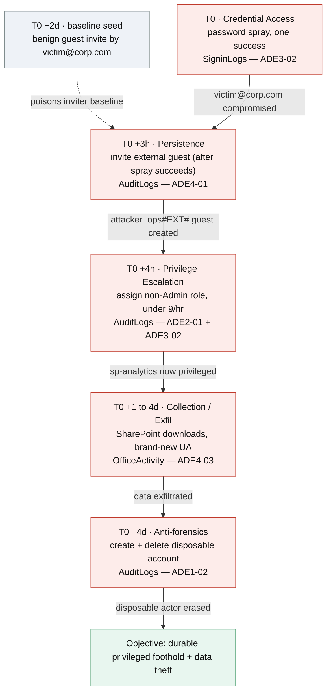

# Challenge 2 — Cloud identity takeover (Entra ID / M365)

**Watchlist id:** `c2-cloud`
**Difficulty:** Medium
 **Tables:** `SigninLogs`,
`AuditLogs`, `OfficeActivity`

One actor sprays their wayed into a tenant, converts that foothold into persitant privilege, exfiltrates SharePoint data low-and-slow, then covers their tracks... every step bypassing a real default Sentinel rule via an ADE logic bug...

## Attack chain over time

## Shared entities (the pivots that thread the chain)

These fixed values appear across steps so a hunter pivoting on any one walks the
whole chain. Fields chosen are the ones the rules actually aggregate/join on.

| Entity | Example value | Appears in | Why it links |
|--------|---------------|-----------|--------------|
| Attacker source IP | `198.51.100.44` | Steps 1 (spray) | Spray rule aggregates by `IPAddress` |
| Compromised user (UPN) | `victim@corp.com` | Steps 1→2 | Sprayed account that succeeds = the inviter in step 2 |
| Disposable guest | `attacker_ops#EXT#@corp.com` | Steps 2→3 | Invited actor that performs the noisy ops |
| Throwaway acct | `tempsvc#EXT#@corp.com` | Step 5 | Created + deleted for anti-forensics (the ADE1-02 join-key trick) |
| Controlled principal | SP `sp-analytics` (objectId) | Step 3 | Target of the privileged role grant |
| Session / UA | `python-requests/2.31` (never in baseline) | Steps 1,4 | Ties spray client to SharePoint pulls; being *new* is exactly what makes step 4 miss (ADE4-03) |
| Timeline anchor | `T0` (spray) → +mins → +hrs → +days | all | Monotonic, plausible spacing |

## Kill chain

| # | Phase (ATT&CK) | Rule (Sentinel source) | Table | ADE bug — why it misses | Kill-chain link |
|---|----------------|------------------------|-------|-------------------------|-----------------|
| 1 | Credential Access (T1110.003) | **Password spray against Entra ID app** — `SolutionsOld/EntraID/.../SigninPasswordSpray` | `SigninLogs` (+`AADNonInteractiveUserSignInLogs`) | **ADE3-02.** Rule fires when `dcount(UserPrincipalName) ≥ 5` per `IPAddress` per **20m** window *and* `GlobalFailPrincipalCount > GlobalSuccessPrincipalCount`. Keep **<5 distinct UPNs per IP per 20m** (pace ~1 attempt/5min) so no window breaches; one attempt succeeds. | Success row for `victim@corp.com` from `198.51.100.44` → that UPN becomes the actor in step 2 |
| 2 | Persistence (T1136.003 / T1078.004) | **Guest Users Invited to Tenant by New Inviters** — `Detections/AuditLogs/GuestUsersInvitedtoTenantbyNewInviters` | `AuditLogs` | **ADE4-01** (+ADE2-01). Fires only when `InitiatingUserPrincipalName !in (inviting_users)` over a 14-day baseline. Seed one benign invite by `victim@corp.com` **>1 day earlier** → the NOT-gate inverts and the malicious invite is treated as an established inviter. | Invite by `victim@corp.com` creates `attacker_ops#EXT#` → deniable actor for step 3 |
| 3 | Privilege Escalation (T1098) | **Bulk Changes to Privileged Account Permissions** — `SolutionsOld/EntraID/.../BulkChangestoPrivilegedAccountPermissions` | `AuditLogs` | **ADE2-01 + ADE3-02.** Keys on `RoleName contains "Admin"`; grant roles whose names lack that substring (`Directory Writers`, custom `read_insights`, `Owner`) and stay under the **>9 assignments/hour** bulk threshold. | Grants a privileged role to `sp-analytics` → durable privilege that reaches M365 data in step 4 |
| 4 | Collection / Exfiltration (T1213 / T1567) | **SharePoint Downloads by New User Agent** — `Solutions/Microsoft 365/.../SharePoint_Downloads_byNewUserAgent` | `OfficeActivity` | **ADE4-03 ✓verified (high).** Despite the name, the rule filters `UserAgent in~ (FrequentUA)` — the *opposite* of "previously unseen user agents". Exfil with a **brand-new custom UA** never seen in the 14-day baseline → it's not in `FrequentUA` → all its events are dropped and the rule never fires, at any volume. *(Secondary ADE3-03: 1-day recent window also lets you spread downloads across days. ADE2-01: `Operation` only covers `FileDownloaded`/`FileUploaded`, so `SharingSet` external-share exfil is invisible.)* | `sp-analytics`/`victim` pulls sensitive SharePoint files with the new UA → the data-theft objective |
| 5 | Defense Evasion / Anti-forensics (T1070) | **Account Created & Deleted in Short Timeframe** — `SolutionsOld/EntraID/.../AccountCreatedandDeletedinShortTimeframe` | `AuditLogs` | **ADE1-02 (Normalization Asymmetry).** Create/delete correlation inner-joins on `TargetUserPrincipalName`, but add-user uses `trim()` while delete-user uses `extract()` stripping a 32-hex GUID prefix. The Add-user event logs the UPN **with** the GUID prefix and the Delete-user event **without** it → the two join keys differ → join fails → no alert. | Create + delete a disposable `tempsvc#EXT#` account with no correlated alert; the step-3 privilege persists |

## Rule reference

| Rule | Reference URL | Data table | ADE bug | Bypass |
|------|---------------|-----------|---------|--------|
| Password spray against Entra ID app | [SigninPasswordSpray.yaml](https://github.com/Azure/Azure-Sentinel/blob/master/Solutions/Microsoft%20Entra%20ID/Analytic%20Rules/SigninPasswordSpray.yaml) | `SigninLogs` (+`AADNonInteractiveUserSignInLogs`) | **ADE3-02** | Fires at ≥5 distinct UPNs per `IPAddress` per 20m *and* fails>successes. Keep <5 UPNs/IP/20m (pace ~1/5min) and let one succeed. |
| Guest Users Invited to Tenant by New Inviters | [GuestUsersInvitedtoTenantbyNewInviters.yaml](https://github.com/Azure/Azure-Sentinel/blob/master/Detections/AuditLogs/GuestUsersInvitedtoTenantbyNewInviters.yaml) | `AuditLogs` | **ADE4-01** (+ADE2-01) | Fires only when `InitiatingUserPrincipalName !in` a 14-day inviter baseline; seed a benign invite by the same UPN >1 day earlier to invert the NOT-gate. |
| Bulk Changes to Privileged Account Permissions | [BulkChangestoPrivilegedAccountPermissions.yaml](https://github.com/Azure/Azure-Sentinel/blob/master/Solutions/Microsoft%20Entra%20ID/Analytic%20Rules/BulkChangestoPrivilegedAccountPermissions.yaml) | `AuditLogs` | **ADE2-01 + ADE3-02** | Keys on `RoleName contains "Admin"` + >9 assignments/hr; grant roles whose names lack "Admin" (`Directory Writers`, custom), staying under 9/hr. |
| SharePoint Downloads by New User Agent | [SharePoint_Downloads_byNewUserAgent.yaml](https://github.com/Azure/Azure-Sentinel/blob/master/Solutions/Microsoft%20365/Analytic%20Rules/SharePoint_Downloads_byNewUserAgent.yaml) | `OfficeActivity` | **ADE4-03** (+ADE3-03/2-01) | Rule filters `UserAgent in~ (FrequentUA)` — opposite of its "unseen UA" intent; use a brand-new UA never in the 14-day baseline → all its events dropped, never fires. |
| Account Created & Deleted in Short Timeframe | [AccountCreatedandDeletedinShortTimeframe.yaml](https://github.com/Azure/Azure-Sentinel/blob/master/Solutions/Microsoft%20Entra%20ID/Analytic%20Rules/AccountCreatedandDeletedinShortTimeframe.yaml) | `AuditLogs` | **ADE1-02** | Create/delete inner-join on `TargetUserPrincipalName` with `trim()` vs `extract()` asymmetry; Add-user logs the UPN with a 32-hex GUID prefix, Delete-user without → join keys differ → no alert. |

## Answer key — Bug Likelihood Test + fixes

[Bug Likelihood Test](https://github.com/NikolasBielski/Adversarial-Detection-Engineering-Framework/blob/main/docs/guides/bug-likelihood-test.md) answered per rule (Y = flags that ADE class; – = n/a). Columns: Spray, Guest-invite, Bulk-changes, SharePoint, Acct create+delete. You need fill this one out this time!

| # | Checklist question | ADE | Spray | Guest | Bulk | ShrPt | Acct |
|---|--------------------|-----|:--:|:--:|:--:|:--:|:--:|
| 1 | Alt method/tool in scope not in a condition? | ADE2-01/04 | – | – | – | – | – |
| 2 | Newer version since authored? | ADE2-02 | – | – | – | – | – |
| 3 | Assumes only certain flavors/locations? | ADE2-03 | – | – | – | – | – |
| 4 | Process-name match + renameable? | ADE3-01 | – | – | – | – | – |
| 5 | A path assumed in a condition? | ADE2-03 | – | – | – | – | – |
| 6 | High string/log manipulation potential? | ADE1-01 | – | – | – | – | – |
| 7 | NOT/AND on attacker-amendable data? | ADE4-01/02 | – | – | – | – | – |
| 8 | Aggregation operators (counts/thresholds)? | ADE3-02 | – | – | – | – | – |
| 9 | New-terms / suppression / entity coupling? | ADE3-02 | – | – | – | – | – |
| 10 | Multi-substring/exact sequence in one event? | ADE3-04 | – | – | – | – | – |
| 11 | Excludes privileged accounts, not for priv-esc? | ADE4-03 | – | – | – | – | – |

## Malicious rows (the needles)

You need to find these. Will be released on 1st December.