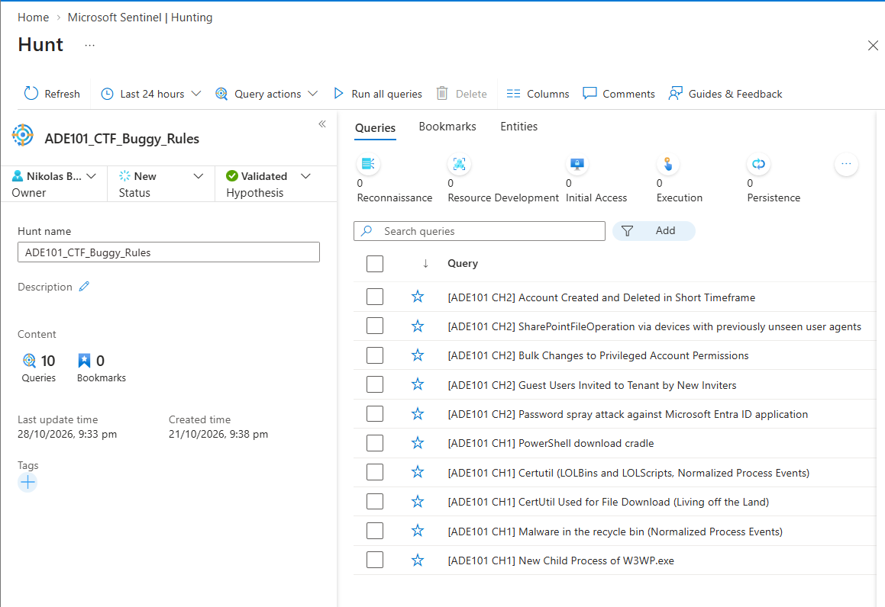
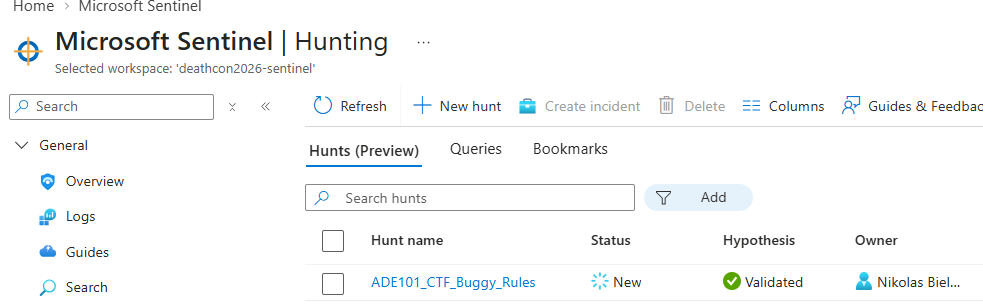

# DEATHcon 2026 · ADE 101 — CTF

You should be able to access via TailScale in your VM, to https://ctf.kiko-turtle.ts.net/ .

**Data to use - these are saved functions that output the Table data**:
- `SecurityEvent_CH1`, or `SecurityEvent_CH1()`
- `Event_CH1`, or `Event_CH1()`
- `ProcessCreate_CH1`, 
- `SigninLogs_CH2`, 
- `AuditLogs_CH2`, 
- `OfficeActivity_CH2`, 

Some output will have unparsed EventData XmL, add the following at the end of your query to beautify the output.
```
| extend ParsedXML = parse_xml(EventData)
| mv-apply DataNode = ParsedXML.DataItem.EventData.Data on (
    summarize DynamicProps = make_bag(pack(tostring(DataNode.["@Name"]), tostring(DataNode.["#text"]))))
| evaluate bag_unpack(DynamicProps)
| project-away ParsedXML
```

---
# CTF

All of the detection logic with logic bugs in the CTF has been added to the workspace as hunting queries. I suggest you first find them, create your own hunt and then run the hunt. You will not get any hits, but the challenges below and thier questions will take you through each hunt/rule, and then you will need to assess the query logic against the ADE taxonomy using the bug likelihood test, in order to find the detection logic bug(s), then write your own KQL to find out if that has been abused in the data! Then, you will be able to answer the CTF questions.

CH1: Easy. Windows Host.
CH2: Moderate. Azure.





> NOTE: When you get "moved to the defender portal" but want to run hunts in old Sentinel, then click on the link, it will open a new tab. Then go back to your original and refresh, you will still have the legacy hunts plane. All comes to worse, you can C&P the query from `ctf-hints.md`.

# Tooling:

- Bug Likelihood Test (Manual or AI driven is ok, just assess and verify in your hunt) https://adeframework.org/docs?file=docs/guides/bug-likelihood-test.md
The bug likelihood test is a manual check list to get started on assessing the detection logic for candidate detection logic bugs.

- ADE skills. https://github.com/Adversarial-Detection-Engineering/adeskills
ADE skills is a large skills repository for adversarial detection engineering, and rule assessments. Use it, it's MIT!

---

# Challenge 1 — Host intrusion

### Rule 0 — [ADE101 CH1] New Child Process of W3WP.exe

- **C1R0-Q1** — The attack generates **zero** 4688s. Which Sysmon **EventID** is the only evidence of the foothold? `[integer]` → `__________`

- **C1R0-F1** — Flag: SHA256 of the `Microsoft.CodeAnalysis.dll` ImageLoad row's `TimeGenerated`. Or the`SHA256` in the XML of the log abusing the logic bug. `[sha256]` → `__________`

Flag fromat:  **C1R0-Q1**-**C1R0-F1**

### Rule 1 — [ADE101 CH1] Certutil (LOLBins and LOLScripts, Normalized Process Events)
(`Certutil-LOLBins` / `Certutil-Download-Abuse`)

- **C1R1-Q1** — Which immutable PE-header **field** still reveals the renamed binary's true identity (and should be the fix key)? `[string]` → `__________`

- **C1R1-Q2** — ADE sub-category of the rename evasion. `[ADEx-yy]` → `__________`

Flag fromat:  **C1R1-Q1**-**C1R1-Q2**


### Rule 2 — [ADE101 CH1] Malware in the recycle bin (Normalized Process Events)

- **C1R2-Q1** — What modern path **substring** does the payload sit under that the legacy `recycler` match misses? `[string]` → `__________`

- **C1R2-Q2** — ADE sub-category. `[ADEx-yy]` → `__________`

Flag fromat:  **C1R2-Q1**-**C1R2-Q2**


### Rule 3 — [ADE101 CH1] PowerShell download cradle

- **C1R3-Q1** — Reconstruct the .NET **class** the cradle builds by concatenation (`'Net.We'+'bClient'`). `[string]` → `__________`

- **C1R3-Q2** — ADE sub-category. `[ADEx-yy]` → `__________`

Flag fromat:  **C1R3-Q1**-**C1R3-Q2**

---

# Challenge 2 — Cloud identity takeover

### Rule 1 — [ADE101 CH2]  Password spray attack against Microsoft Entra ID application

- **C2R1-Q1** — The compromised **UPN** (the account that succeeded). `[upn]` → `__________`
- **C2R1-Q2** — ADE sub-category. `[ADEx-yy]` → `__________`

Flag fromat:  **C2R1-Q1**-**C2R1-Q2**

### Rule 2 — [ADE101 CH2] Guest Users Invited to Tenant by New Inviters

- **C2R2-Q1** — The guest **UPN** created by the malicious invite. `[upn]` → `__________`

- **C2R2-Q2** — ADE sub-category. `[ADEx-yy]` → `__________`

Flag fromat:  **C2R2-Q1**-**C2R2-Q2**

### Rule 3 — [ADE101 CH2]  Bulk Changes to Privileged Account Permissions

- **C2R3-Q1** — The **custom role** name granted to the service principal. `[string]` → `__________`

- **C2R3-Q2** — ADE sub-category for the **role-name coverage gap** (roles without "Admin"). `[ADEx-yy]` → `__________`

Flag fromat:  **C2R3-Q1**-**C2R3-Q2**

### Rule 4 — [ADE101 CH2] SharePointFileOperation via devices with previously unseen user agents
- **C2R4-Q1** — The **operator** in the rule's `UserAgent` filter that catches frequent UAs, but not new ones. `[string]` → `__________`

- **C2R4-Q2** — ADE sub-category. `[ADEx-yy]` → `__________`

Flag fromat:  **C2R4-Q1**-**C2R4-Q2**

### Rule 5 — [ADE101 CH2] Account Created and Deleted in Short Timeframe

- **C2R5-Q1** — The length, in **hex characters**, of the GUID prefix on the `Add user` UPN that breaks the correlation join. `[integer]` → `__________`

- **C2R5-Q2** — The bug's ADE sub-category. `[ADEx-yy]` → `__________`

Flag fromat:  **C2R5-Q1**-**C2R5-Q2**