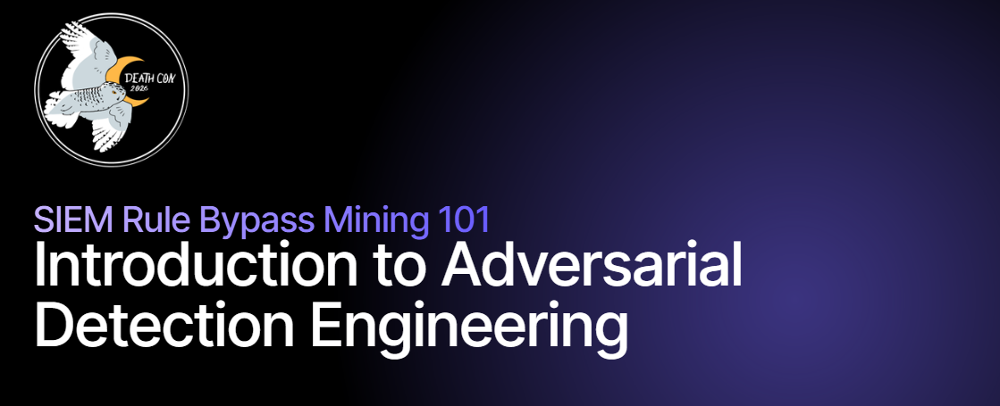
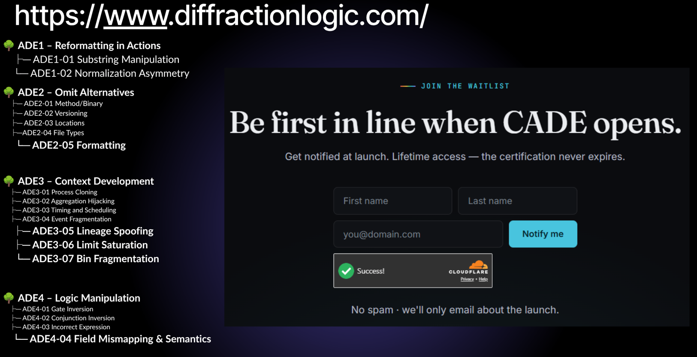

### SIEM Rule Bypass Mining 101 (ADE101)
## Introduction to Adversarial Detection Engineering

Workshop Leader:  Nikolas Bielski [LinkedIn](https://www.linkedin.com/in/nikbielski/)

The full workshop presentation videos can be found on:
- [Vimeo](https://vimeo.com/deathcon/siem-rule-bypass) or
- [YouTube (Private)](https://youtu.be/mu9meDA5UVE)

Make sure to use at least 720p!

--------------------------------------------------------------------------

## Kia Ora Te DEATH Whanau!!! Welcome fellow DEATH Reapers to DEATHCon ADE101! 

I'm so excited to deliver this workshop to you! It's been a long time coming, and I've put a ton of time into it to make sure you leave with a lot of knowledge and new skills. 

There's a truck load of content for you to work through. It's low key a mini course to get through it all! That's cool though, you are a Reaper, so are beyond time right?

This is a hybrid hands-on workshop on **Adversarial Detection Engineering
(ADE)**. There are a few parts, and the more you complete, the more you gain!

**NOTE: In the video, I forgot to answer a key question.**
> "If Adversarial Detection Engineering involves hunting for abusable detection logic bugs in theat detection logic.. then that activity itself should map to somewhere in the MITRE ATT&CK Framework right?

**Spot on**.   This practice maps to **T1211 - Exploitation for Stealth**. This tactic assumes logging and monitoring remains in place. The goal is to abuse the bugs in detection controls/tooling to hide activity, NOT impair them. So by assessing detection logic (which is software) for bugs that can be abused (CWE-697 Incorrect Comparison pillar, see it's children) and then changing activity to abuse them and result in a bypass the logic, then that is T1211 - Exploitation for Stealth.

**Honestly, to level with you.** If a product is made to detect threats using logs, and then it's logic has CWE mappable bugs that can be abused so that it doesn't detect threats, and the actual activity of the abuse maps to attacker behaviour in MITRE ATT&CK... then in my abosulte honest opinion, that should mean that **every single one of these detection logic bugs should be CVEs.** The fact that it's not considered in-scope for CVEs and bug bounties is *completely ironic*..

But oh well..  

## Workshop Contents

- **PART 1: Lecture presentation** about ADE, Definitions, Taxonomy. Foundations.
    - ~60 mins - includes a 5 min break
- **PART 2: Lab walk through**. You emulate, focusing on MS Sentinel Rules/Hunts. Walk through ADE assessments manually.
    - ~60 mins
- **PART 3: Capture The Flag**. Challenge 1 continues from the Lab Scenario, Challenge 2 is a new scenario for you to work through.
    - ~60 mins
- **PART 4: PR or Issue raise on public repo**. Final challenge is finding and submitting a PR/Issue to Open Source. Candidate Bypass list to follow.
    - ~60 mins
- **ADE101 DEaTHCon26 Challenger Digital Badge!**  If you complete PART 3 and Part 4, you will get a digital badge and public kudos from ADE community! <3
    - Part 4: ~120 mins

**Total time** 6 hours for someone with KQL experience, maybe a bit longer if you're a beginner. DEATHCon discord is open until 1st January 2027. I will keep PART 4 submissions open up to 1st December 2026.

> **DEATHcon participation only**: I have released this video and workshop materials on YouTube+Github.. But participation in the workshop, activities, CTF, digital badge, access to myself for Q&A in chat - is only open to DEATHcon 2026 participants. 

**Requirements:**
- Access to DEATHLAB.net Microsoft Sentinel. If you don't want to use the DEATHLAB.net lab, you can setup your own MS Sentinel workspace using [self-setup.md](TO_UPLOAD\Setup\self-setup.md)
- Optional:  A Lab VM, used for emulation and running the rules to be examined. As per the [lab VM guide](https://deathcon.io/lab-setup.html#troubleshooting). 

**Notes on Q&A/Help/Support**

Please note that, you are probably in another country as me! So we have different time zones. I am in New Zealand, currently UTC+13:00 (EST is UTC-5).

*Soooooo* if you have any questions, please consider that **it might take some time for me to get back to you**. I will *of course* endevour to be avaliable as much as possible! But please keep this in mind if I don't reply too quickly.

**Q & A process**:
1.  **Check the workshop channel in case your question has been answered already.** No question is a silly question! Don't be afraid to ask. We all know everything and nothing at the same time, so are the same.
2.  **Ask in the workshop channel if not**, so that others can prosper from your questions. <3
3.  If the question is for a Challenge in the CTF, **try the hint process first** (found in each CTF Challenge Folder in [CTF](CTF))
4.  **Help each other!** Pair up! If you know an answer, get some kudos and help out your fellow Reaper. We are a community afterall <3
5.  Last of all, enjoy it!

---

## Useful Links

During this workshop, you may find the following links useful.
- PART 1 Video. https://vimeo.com/deathcon/siem-rule-bypass

- ADE Github Organization page.  https://github.com/Adversarial-Detection-Engineering

- ADE website.                   https://adeframework.org/

- Azure portal                   https://portal.azure.com/#home

---

## The two challenges

| CH# | Challenge | Tables | Steps | Difficulty |
|---|-----------|--------|-------|-----------|
| **1** | **Scenario: Host intrusion:** Fileless IIS foothold laundered through WMI, staged via a renamed LOLBin, to C2 | `SecurityEvent` (4688), Sysmon (1/3/7/11) | 1 logic-bug + 3 x Detection Logic Bugs | Beginner, extension of the Lab |
| **2** | **Scenario: Cloud identity takeover:**. password spray, guest persistence,  privilege escalation, to SharePoint exfil and anti-forensics | `SigninLogs`, `AuditLogs`, `OfficeActivity` | 5 x Detection Logic Bugs | Intermediate |

Each challenge is log analysis of an actor working through a kill chain that abuses Detection Logic Bugs in the in-scope SIEM Rules or Hunts. Every step hands an entity (an IP, a UPN, a guest, a principal, a file path) to the next, so when you figure out a bypass, you then can pivot on what it gives you into the following bypass (attacker graph concept).

---

## How to work each step

To get the best out of this workshop, you should try to follow the following steps during the challenges.

1. **Misses.** Start from the `hunts/` query for that step (or the rule's own query).
   Run it as-is on this data (it returns *nothing*, or misses the bypass). 
2. **ADE Assessment.** Which **ADE family** explains the miss? Use the Bug Likelihood Test.
3. **Capture.** Find the malicious rows the rule *should* have caught. Record the
   key entities (who/what/when/where). These will help with the CTF questions.
4. **Fix. (optional)** Rewrite the rule so it catches this attack *without* drowning in false
   positives. Note what your fix changes and why.
5. **Record it in the CTF portal (or question sheet).** Submit flags to CTF app. But also note them down.

Stuck on a CTF question? [`CTF_hints.md`](CTF_hints.md) gives three escalating tiers per step, as well as the orginal query and the workshop-amended version (i.e SigninLogs is SigninLogs_CH2() )

---

## Life time labs, life time active cert (module based) Certified Adversarial Detection Engineer (CADE)

I'll be releasing a "Certified Adversarial Detection Engineer (CADE)" course in 2027!
- Lifetime access, pay once (likely to be ~$800 USD). Waiting list joiners get a 40% off offer when early bird is out.
- War games to test your emulation and ADE skills, real time race against attacks, real world based scenarios.
- Newly updated content and modules as security research continues on ADE
- Module based and lab heavy. Complete all the modules and get the cert kind of approach.
- Really for those who want to get their hands dirty on pratical detection and evasion of detection logic and have advanced to expert level modules/challenges.

### Sooo join the waitlist if you are keen!  https://www.diffractionlogic.com/#cta

# Happy Bypass Mining ! Hope you have fun!

Acknowledgements:

- See [ACKNOWLEDGEMENTS.md](ACKNOWLEDGEMENTS.md) for full credits.

---

## Disclaimers

### Views are my own

- The views, opinions, and assessments in this workshop, its contents, and the accompanying recordings, are solely my own and do not represent my employer, DEATHCon, its organisers, or any other individual or organisation.
- Any commentary on specific products, rules/hunts/queries, or vendors reflects my personal experience and testing against specific versions at a specific point in time, is offered as honest opinion rather than statement of fact, and may not reflect current product behaviour.
- All trademarks and product names are the property of their respective owners; references are for identification and educational purposes only and do not imply affiliation or endorsement.
- The materials are provided “as is,” for educational purposes, without warranty of any kind, and are not professional or legal advice.

### Authorised, ethical use only

This workshop teaches **adversarial detection engineering for defenders**. The emulation steps, bypass techniques, and atomics are intended **only** for use in **your own lab environment**, or on systems you are **explicitly authorised in writing** to test.

- **Do not** run any technique, payload, or emulation against systems, networks, accounts, or data you do not own or have documented permission to test.
- Unauthorised access to, or interference with, computer systems is illegal in most countries — including under New Zealand's Crimes Act 1961 (ss 249–252), the United States' Computer Fraud and Abuse Act, and equivalent laws elsewhere.
- You alone are responsible for how you use this material. By using it, you agree to do so lawfully and ethically, and you accept all responsibility and risk for your actions.
- If you discover a real vulnerability in a product or a live environment, follow responsible disclosure — report it to the owner; do not exploit or publicise it.

The author and DEATHCon accept no liability for any misuse of, or damage arising from, these materials.
